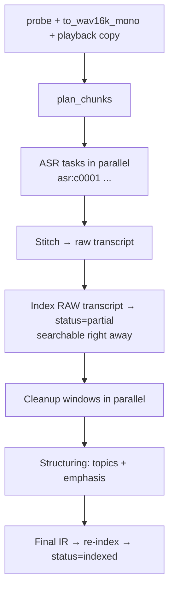

# Phase 4: Audio (teacher recordings)

**Goal:** turn lecture recordings (audio or video) into a clean, structured, timestamped transcript that is searchable in chat. Citations link to the exact moment, and the teacher's emphasis ("ça va tomber à l'examen", "this will be on the exam") is detected.

**Estimate:** ~1 week · **Depends on:** Phase 1 (Phase 2 recommended)

**Phase done when:** a 1-hour French lecture is transcribed, cleaned, structured and searchable in **under ~10 minutes**; a chat answer cites a timestamp, and clicking it plays the audio from that moment; WER on a hand-transcribed 5-minute excerpt is measured.

---

## Task list

| ID | Task | Est. |
|----|------|------|
| P4-T01 | Migration + router (audio and video kinds) | 0.25 d |
| P4-T02 | ffmpeg wrapper | 0.5 d |
| P4-T03 | Silence-based chunking | 0.5 d |
| P4-T04 | ASR provider (Riva) | 1 d |
| P4-T05 | Local ASR fallback (faster-whisper) | 0.5 d |
| P4-T06 | Transcript stitching | 0.25 d |
| P4-T07 | Transcript cleanup with glossary | 0.5 d |
| P4-T08 | Structuring: topics + teacher emphasis | 0.5 d |
| P4-T09 | Transcript → IR blocks + chunking | 0.25 d |
| P4-T10 | Ingest job (progressive) | 0.5 d |
| P4-T11 | UI: player, transcript viewer, timestamp citations | 0.5 d |
| P4-T12 | Audio eval + tests | 0.5 d |

**System dependency:** ffmpeg (`winget install Gyan.FFmpeg`). Restart the terminal afterwards and check `ffmpeg -version`.

**New requirements:**
```
nvidia-riva-client
faster-whisper        # optional local fallback (CPU int8)
```

**New config:**
```yaml
upload:
  allowed_kinds: [pdf, text, markdown, image, docx, pptx, audio]
  max_audio_minutes: 180

models:
  asr:
    id: openai/whisper-large-v3
    function_id: "<copy from the model page on build.nvidia.com>"
    language_code: multi          # check the model page: 'multi' / 'fr-FR' / 'en-US'
    rpm: 30
    max_in_flight: 6
  asr_local:
    id: small                     # faster-whisper model size: small | medium | large-v3
    device: cpu
    compute_type: int8

audio:
  sample_rate: 16000
  max_chunk_s: 30
  min_silence_s: 0.4
  silence_db: -35
  cleanup_window_s: 120
  block_target_s: 45              # transcript paragraph length in the IR

pipeline_versions:
  audio: "1"
```

---

### P4-T01: Migration + router

**Migration `005_audio.sql`:**
```sql
ALTER TABLE documents ADD COLUMN audio_path TEXT;      -- normalized 16 kHz mono WAV
ALTER TABLE documents ADD COLUMN playback_path TEXT;   -- browser-playable file (original or converted)
```
(`documents.duration_s` already exists from Phase 1.)

**Router:** audio = mp3, m4a/aac, wav, ogg/opus, flac, webm (audio-only); video = mp4, mov, mkv, webm (with video). Both → kind `audio`. Use `ffprobe` (P4-T02) to read the duration and reject files longer than `max_audio_minutes`.

---

### P4-T02: ffmpeg wrapper

**File:** `core/ingestion/audio/ffmpeg.py`

```python
def check_ffmpeg() -> None: ...                         # clear error if ffmpeg/ffprobe aren't on PATH
def probe(path: Path) -> AudioInfo: ...                  # duration, codec, channels, sample rate, has_video
def to_wav16k_mono(src: Path, dst: Path) -> None:
    # ffmpeg -y -i src -vn -ac 1 -ar 16000 -af loudnorm=I=-20:TP=-2 -c:a pcm_s16le dst
def to_playback(src: Path, dst: Path) -> None:
    # if the browser can't play the original (e.g. mkv, some m4a codecs): -vn -c:a libopus -b:a 48k dst.ogg
def cut(src_wav: Path, start_s: float, end_s: float) -> bytes:
    # read the PCM slice directly from the WAV (fast, no subprocess)
```

Run ffmpeg with `subprocess.run([...], check=True, capture_output=True)` inside the CPU pool or `asyncio.to_thread`. Show ffmpeg's stderr in the error message when it fails.

---

### P4-T03: Silence-based chunking

**File:** `core/ingestion/audio/segment.py`

ASR works best on chunks ≤ 30 s that are **cut at silences**, not in the middle of words.

**Approach (no extra dependency):** use ffmpeg's `silencedetect` filter:
```
ffmpeg -i audio.wav -af silencedetect=noise=-35dB:d=0.4 -f null -
```
Parse the `silence_start` / `silence_end` lines from stderr.

**Packing algorithm:**
1. Speech regions = the complement of the silences.
2. Walk the regions and grow the current chunk until adding the next region would exceed `max_chunk_s`. Then cut at the **middle of the silence** between them.
3. A single speech region longer than `max_chunk_s` (no pauses) → hard cut every `max_chunk_s − 1` s with **1 s overlap** (handled in stitching).
4. Drop chunks with no speech (pure silence or noise under 0.5 s).

```python
class AudioChunk(BaseModel):
    index: int
    start_s: float
    end_s: float
    hard_cut: bool = False

def plan_chunks(wav: Path) -> list[AudioChunk]: ...
```

> If silence detection struggles with noisy classrooms, switch to **Silero VAD** (more robust, but needs `torch`) or use faster-whisper's built-in VAD for the local path.

**Tests:** synthetic audio with pydub/numpy (tone blocks separated by silences) → chunk boundaries fall inside the silences; no chunk > 30 s.

---

### P4-T04: ASR provider (Riva)

**File:** `core/providers/asr.py`

NVIDIA's hosted speech models are called through the **Riva gRPC client** with the model's `function-id`. The client is synchronous, so run it in a thread under the limiter:

```python
import riva.client

def _service() -> riva.client.ASRService:
    cfg = get_settings().models["asr"]
    auth = riva.client.Auth(
        uri=get_settings().section("nvidia")["grpc_server"],
        use_ssl=True,
        metadata_args=[["function-id", cfg.function_id],
                       ["authorization", f"Bearer {get_settings().secrets.nvidia_api_key}"]],
    )
    return riva.client.ASRService(auth)

class AsrSegment(BaseModel):
    start_s: float          # absolute (chunk start + offset)
    end_s: float
    text: str
    words: list[tuple[str, float, float]] | None = None
    language: Lang | None = None
    confidence: float | None = None

async def transcribe_chunk(wav_bytes: bytes, chunk: AudioChunk, *, language_hint: str | None) -> list[AsrSegment]:
    def call():
        config = riva.client.RecognitionConfig(
            language_code=language_hint or cfg.language_code,
            max_alternatives=1,
            enable_automatic_punctuation=True,
            enable_word_time_offsets=True,
            audio_channel_count=1,
            sample_rate_hertz=16000,
            encoding=riva.client.AudioEncoding.LINEAR_PCM,
        )
        return _service().offline_recognize(wav_bytes, config)
    async with limiter.slot("asr"):
        resp = await asyncio.to_thread(call)
    # results → alternatives[0].transcript (+ words with start/end if provided)
```

Notes:
- **Check the model page** for: the `function-id`, supported `language_code` values (auto-detect vs fixed), whether word timestamps are returned, and the maximum audio length per request.
- If word timestamps aren't returned, use **chunk-level timestamps** (chunk start/end). With ≤ 30 s chunks, that's precise enough for "jump to this moment".
- **Cache** by `sha256(wav_bytes) + model + language`.
- **Language**: if the whole lecture is clearly in one language (detect it on the first 3 chunks), pass that language explicitly for the remaining chunks. That's often more accurate than auto-detect.
- Retry on gRPC `UNAVAILABLE` / `RESOURCE_EXHAUSTED` with backoff.

**Alternative model:** `nvidia/canary-1b` (multilingual, FR + EN). Make the model switchable in config and compare WER in P4-T12.

---

### P4-T05: Local ASR fallback (faster-whisper)

**File:** `core/providers/asr_local.py`

- `WhisperModel(cfg.id, device="cpu", compute_type="int8")`, loaded once (in the worker only).
- `model.transcribe(path, vad_filter=True, word_timestamps=True, language=lang_or_None)` → segments with timestamps.
- Used when Riva fails for a chunk after retries, or when `asr.provider: local` is set in config (offline development).
- CPU speed: `small` is roughly real-time or faster on a laptop; `large-v3` on CPU is **slow** (for occasional use only).

---

### P4-T06: Transcript stitching

**File:** `core/ingestion/audio/stitch.py`

- Sort segments by `start_s`.
- For **hard cuts with overlap**: remove duplicated words at the boundary. Compare the last ~8 words of chunk N with the first ~8 of chunk N+1 (folded), find the longest common overlap, and drop it from N+1.
- Output `RawSegment(id, start_s, end_s, text, language)` with stable IDs `s0001, s0002, ...`.

---

### P4-T07: Transcript cleanup with glossary

**File:** `core/ingestion/audio/cleanup.py`

**Glossary** (`build_glossary(notebook_id) -> list[str]`): terms from the other documents in the notebook: headings, bold terms, terms that recur in chunks, and concept names (once Phase 5 exists). Keep up to ~150 terms. This helps fix ASR errors on technical words (for example "chlorophylle", "mitochondrie", variable names).

**Cleanup** on windows of ~`cleanup_window_s` (in parallel):
- Input: a JSON list of `{id, text}` segments + the glossary + the language.
- Prompt: "Fix punctuation and capitalization. Remove filler words (euh, bah, um, you know) and false starts. Correct words that are clearly ASR mistakes, using the glossary. **Don't add, remove or reorder ideas. Don't summarize.** Return the **same IDs** with the corrected text as JSON."
- Validate: same IDs, same count. Per segment, apply the guarded check from P3-T05 with a **looser threshold** (ratio ≥ 70, length 0.6–1.15, because filler removal shortens text). Rejected segments keep the raw text.
- Because IDs are preserved, **timestamps are preserved**.

---

### P4-T08: Structuring: topics + teacher emphasis

**File:** `core/ingestion/audio/structure.py`

**Topic segmentation:**
- Run over the cleaned transcript in windows (~10 min, with 1 min overlap). The `chat` model returns `[{"start_id": "s0123", "title": "La phase lumineuse"}]`, the points where a new topic starts.
- Merge the windows and drop duplicate topic starts in overlaps (same or adjacent IDs).
- Topics become `heading` blocks (level 2) inserted before their start segment. The `section_path` follows from them.

**Teacher emphasis:**
1. **Deterministic patterns** (FR + EN, case and accent folded), for example:
   - `(ça|cela) (va|peut) tomber (à|a) l'?examen`, `retenez( bien)?`, `c'est (très )?important`, `à savoir par c(oe|œ)ur`, `notez bien`, `attention`, `piège`, `je vous le redis`, `point clé`
   - `(this|that) (will|might) be on the (exam|test)`, `remember (this|that)`, `(this is|it's) (very )?important`, `key point`, `make sure you know`
2. **LLM confirmation**: for each match, give the `fast` model the surrounding ±3 segments and ask what exactly the teacher emphasizes, and whether it's real emphasis (not "this isn't important"). Output: `{is_emphasis, what, segment_ids}`.
3. Mark the covered segments `important=True` and store `what` as an emphasis note (in the block's debug data). The résumé and quizzes use it.

---

### P4-T09: Transcript → IR blocks + chunking

**File:** `core/ingestion/audio/to_ir.py`

- Group consecutive segments into `transcript_segment` blocks of about `block_target_s` seconds, **never crossing a topic heading**, and split when the `important` flag changes (so emphasis stays precise).
- Each block: `start_s`, `end_s`, `language`, `important`, `extractor="whisper"` (or the model used), `confidence`.
- The chunker (P1-T18) already handles `start_s` / `end_s`. Chunk metadata gets the min start and max end.
- **Citation display**: `cours_12_mars.m4a · 14:32`.

---

### P4-T10: Ingest job (progressive)

**File:** `core/ingestion/jobs.py` (extend)



- Report progress as "minutes transcribed / total minutes".
- If some ASR chunks fail (even after the local fallback), insert a block `[audio non transcrit 12:30–13:00]` ("audio not transcribed") with a warning, and continue.
- **Throughput:** with `max_in_flight: 6` and ~30 RPM, a 60-minute lecture (~130 chunks) needs ~4–5 minutes of ASR. Cleanup and structuring add ~1–3 minutes. Adjust to your real rate limits.

---

### P4-T11: UI: player, transcript viewer, timestamp citations

- **IR viewer for audio**: an `st.audio(playback_path)` player at the top. The transcript is listed with `[mm:ss]` buttons (clicking one re-renders the player with `start_time=seconds`). Topic headings are shown as section titles, and emphasis segments are highlighted with the "what" note.
- **Chat citations** for audio show `▶ 14:32` and play the audio from that time in an expander.
- **Progress**: minutes transcribed, then the cleanup and structure stages.

---

### P4-T12: Audio eval + tests

**Eval:**
- Hand-transcribe **5 minutes** of a real lecture (different parts: start, middle with technical terms, a noisy part). Compute WER (`jiwer`) for: raw ASR (Whisper), raw ASR (Canary, if available), and after cleanup. Cleanup should **lower** WER on technical terms without adding content.
- **Timestamp check**: pick 10 sentences, note their real time by listening, and compare them with the block timestamps (target: within ±5 s).
- **Emphasis**: list the emphasis moments you hear in a 20-minute section, then compute precision and recall of the detection.
- Add Q&A items whose source is the recording (`sources: [{"filename": "...m4a", "time": 872}]`). For retrieval hit, a chunk is relevant when the time falls within `[start_s − 15, end_s + 15]`.

**Tests:**
- Silence planner (synthetic audio).
- Stitching overlap removal.
- Cleanup guard rejects a cleanup that adds a sentence.
- Emphasis regexes match the FR/EN examples and ignore "ce n'est pas important".

---

## Phase 4 checklist

- [ ] P4-T01 migration + router
- [ ] P4-T02 ffmpeg wrapper
- [ ] P4-T03 chunking
- [ ] P4-T04 Riva ASR
- [ ] P4-T05 local fallback
- [ ] P4-T06 stitching
- [ ] P4-T07 cleanup + glossary
- [ ] P4-T08 topics + emphasis
- [ ] P4-T09 IR + chunking
- [ ] P4-T10 job
- [ ] P4-T11 UI
- [ ] P4-T12 eval + tests
- [ ] **Acceptance:** 1-hour lecture searchable in < ~10 min, timestamp citations play at the right moment, WER measured
