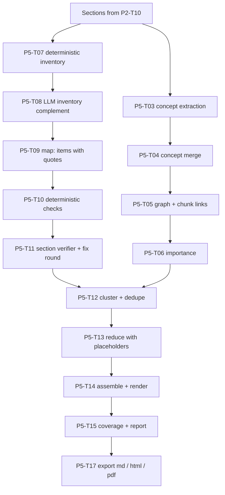

# Phase 5: Verified résumé + concepts

**Goal:** generate an exam-night summary ("Résumé de veille d'examen") that is **complete and correct**. Every important item is found (inventory), extracted with a verbatim quote, checked by code and by a verifier model, and inserted into the summary **by code**, so definitions and formulas are never retyped by an LLM. Build the **concept graph** at the same time; Phases 6 and 7 depend on it.

**Estimate:** ~2 weeks · **Depends on:** Phase 2 (sections + summaries + verifier model)

**Phase done when:** on a full course notebook, **inventory recall ≥ 95%** (against a hand-made list for 2 chapters), **100%** of included definitions and formulas either pass the deterministic checks or are visibly flagged ⚠️, and a manual review of 2 chapters finds **no wrong formula or definition**.

---

## How it fits together



**Key idea:** the expensive per-section work (inventory, map, checks, verifier) produces **items** that are stored and reused. Changing résumé options (language, detail level, scope) only reruns the cheap reduce and assemble steps.

---

## Task list

| ID | Task | Est. |
|----|------|------|
| P5-T01 | Migration `006_resume_concepts.sql` | 0.25 d |
| P5-T02 | Section units (shared helper) | 0.25 d |
| P5-T03 | Concept extraction per section | 0.5 d |
| P5-T04 | Concept merge across sections and documents | 0.75 d |
| P5-T05 | Concept graph + concept ↔ chunk links | 0.5 d |
| P5-T06 | Concept importance | 0.25 d |
| P5-T07 | Inventory: deterministic detectors | 1 d |
| P5-T08 | Inventory: LLM complement | 0.5 d |
| P5-T09 | Map: item extraction with quotes | 0.75 d |
| P5-T10 | Deterministic checks | 1 d |
| P5-T11 | Section verifier + fix round | 0.75 d |
| P5-T12 | Clustering into topics + cross-document dedupe | 0.5 d |
| P5-T13 | Reduce with placeholders | 1 d |
| P5-T14 | Assemble + render (FR/EN, detail levels) | 0.75 d |
| P5-T15 | Coverage + verification report | 0.5 d |
| P5-T16 | Résumé job, caching, incremental updates | 0.5 d |
| P5-T17 | Export: Markdown, HTML, PDF | 0.5 d |
| P5-T18 | UI: Résumé tab + mind map | 0.5 d |
| P5-T19 | Résumé eval | 0.5 d |

**New requirements:** `rapidfuzz` (if not added in Phase 3), `networkx`, `playwright` (PDF export; run `playwright install chromium` once)

**New config:**
```yaml
concepts:
  merge_similarity: 0.88         # embedding cosine above which two concepts are merge candidates
  role_extract: fast
  role_merge_confirm: fast

resume:
  role_inventory: fast
  role_map: chat
  role_verify: verifier
  role_reduce: chat
  quote_min_ratio: 95            # rapidfuzz partial_ratio for verbatim quotes
  verify_sample_other_items: 0.3 # share of non-definition/non-formula items sent to the verifier
  max_fix_rounds: 1
  essentials_count: 10

pipeline_versions:
  concepts: "1"
  inventory: "1"
  map: "1"
  verify: "1"
  reduce: "1"
```

---

### P5-T01: Migration `006_resume_concepts.sql`

```sql
CREATE TABLE concepts (
  id TEXT PRIMARY KEY,
  notebook_id TEXT NOT NULL,
  name_fr TEXT,
  name_en TEXT,
  aliases_json TEXT NOT NULL DEFAULT '[]',
  short_def TEXT,                       -- one line, from the sources
  importance REAL NOT NULL DEFAULT 0,
  emphasis INTEGER NOT NULL DEFAULT 0,  -- teacher emphasis count
  first_section_key TEXT,
  created_at TEXT NOT NULL
);
CREATE INDEX idx_concepts_nb ON concepts(notebook_id);

CREATE TABLE concept_edges (
  notebook_id TEXT NOT NULL,
  src TEXT NOT NULL REFERENCES concepts(id) ON DELETE CASCADE,
  dst TEXT NOT NULL REFERENCES concepts(id) ON DELETE CASCADE,
  type TEXT NOT NULL,                   -- prerequisite | related | part_of
  weight REAL NOT NULL DEFAULT 1,
  PRIMARY KEY (src, dst, type)
);

CREATE TABLE concept_chunks (
  concept_id TEXT NOT NULL REFERENCES concepts(id) ON DELETE CASCADE,
  chunk_id TEXT NOT NULL,
  doc_id TEXT NOT NULL,
  strength REAL NOT NULL DEFAULT 1,     -- 1 = taught here, 0.5 = mentioned
  PRIMARY KEY (concept_id, chunk_id)
);

CREATE TABLE inventory_items (
  id TEXT PRIMARY KEY,
  notebook_id TEXT NOT NULL,
  doc_id TEXT NOT NULL,
  section_key TEXT NOT NULL,
  type TEXT NOT NULL,                   -- definition | formula | theorem | rule | date | number | method | emphasis | key_concept
  label TEXT NOT NULL,                  -- short name, e.g. the term
  block_id TEXT NOT NULL,
  span_start INTEGER,
  span_end INTEGER,
  anchor TEXT NOT NULL,                 -- verbatim source text of the span
  detector TEXT NOT NULL,               -- regex:<name> | formula_block | emphasis | llm
  priority INTEGER NOT NULL DEFAULT 2,  -- 1 = must (definitions, formulas, emphasis), 2 = should, 3 = nice
  section_hash TEXT NOT NULL
);
CREATE INDEX idx_inv_section ON inventory_items(section_key);

CREATE TABLE resume_items (
  id TEXT PRIMARY KEY,
  notebook_id TEXT NOT NULL,
  doc_id TEXT NOT NULL,
  section_key TEXT NOT NULL,
  type TEXT NOT NULL,
  term TEXT,
  quote TEXT,                           -- verbatim from source
  latex TEXT,                           -- formulas
  explanation TEXT,                     -- simpler wording, source language
  source_json TEXT NOT NULL,            -- {doc_id, filename, page, start_s, block_ids}
  inventory_ids_json TEXT NOT NULL DEFAULT '[]',
  concept_ids_json TEXT NOT NULL DEFAULT '[]',
  status TEXT NOT NULL,                 -- extracted | verified | needs_check | rejected
  checks_json TEXT,                     -- results of every check, with reasons
  duplicate_of TEXT,                    -- set by cross-document dedupe
  section_hash TEXT NOT NULL
);
CREATE INDEX idx_items_section ON resume_items(section_key);

CREATE TABLE resumes (
  id TEXT PRIMARY KEY,
  notebook_id TEXT NOT NULL,
  options_json TEXT NOT NULL,           -- language, detail, scope, focus_weak
  content_hash TEXT NOT NULL,           -- hash(all section_hashes in scope + options + versions)
  status TEXT NOT NULL,                 -- running | done | failed
  markdown TEXT,
  report_json TEXT,
  created_at TEXT NOT NULL
);
```

---

### P5-T02: Section units (shared helper)

**File:** `core/indexing/sections.py`

Move the section-building logic from P2-T10 here so summaries, concepts, the inventory and the map all use the **same sections**.

```python
class Section(BaseModel):
    key: str                 # f"{doc_id}:{sha1('/'.join(section_path))[:10]}"
    doc_id: str
    filename: str
    section_path: list[str]
    blocks: list[Block]
    text: str                # blocks joined, with block markers: "⟦b:<block_id>⟧ text"
    hash: str                # sha256 of block texts → drives caching
    language: Lang
    pages: tuple[int | None, int | None]

def sections_for_notebook(notebook_id: str, doc_ids: list[str] | None = None) -> list[Section]: ...
```

The `⟦b:id⟧` block markers let LLM outputs point to exact blocks. Strip them anywhere text is shown to the student.

---

### P5-T03: Concept extraction per section

**File:** `core/indexing/concepts.py`

```python
class ExtractedConcept(BaseModel):
    name: str                     # as written in the source
    name_other_lang: str          # translation (FR↔EN)
    aliases: list[str] = []       # abbreviations, synonyms used in the text
    taught_here: bool             # defined or explained here (vs only mentioned)
    block_ids: list[str]
    prerequisites: list[str] = [] # names of concepts needed to understand this one
    part_of: str | None = None    # broader concept

class SectionConcepts(BaseModel):
    concepts: list[ExtractedConcept]
```

- Role `fast`, run in parallel over sections, cached by `section.hash`.
- Prompt rules: only concepts that appear in the text; no generic words ("introduction", "exemple"); 3–15 concepts per section; prerequisites only if the text implies them, or if they're standard dependencies of a concept that is in the text.
- Validate: each `block_ids` entry must exist in the section; drop concepts whose name (folded) doesn't appear in the section text **unless** an alias does.

---

### P5-T04: Concept merge across sections and documents

**File:** `core/indexing/concepts.py`

The same concept appears in many sections and documents, in two languages ("photosynthèse" / "photosynthesis"; "ATP" / "adénosine triphosphate").

1. **Exact merge**: same folded name, alias or translation → same concept (union-find).
2. **Embedding candidates**: embed `"{name} / {name_other_lang}: {short context}"` for each remaining group. Pairs with cosine ≥ `merge_similarity` are candidates.
3. **LLM confirmation** (`fast`, batched, ~20 pairs per call): "Same concept? yes/no". Merge the confirmed pairs.
4. Canonical record: `name_fr` and `name_en` (most frequent forms), `aliases`, `short_def` (from the first block where `taught_here`), `first_section_key`.

**Stability:** when documents are added, reuse existing concept IDs. Match new concepts against existing ones first, and create new rows only for new concepts. Learner data (Phase 7) is attached to concept IDs, so they must not change on every run.

---

### P5-T05: Concept graph + concept ↔ chunk links

**File:** `core/indexing/concept_graph.py`

- **Edges:** `prerequisite` from the extraction (resolve names to concept IDs, drop the unresolved ones), `part_of` from `part_of`, `related` = co-occurrence in ≥ 2 sections (weight = count).
- **Cycle check** on prerequisite edges (`networkx.find_cycle`): drop the weakest edge of each cycle.
- **Chunk links:** for each concept, the chunks containing its `block_ids` get strength 1 (taught). Chunks whose text contains the name or an alias (folded, whole word) get strength 0.5 (mentioned).
- **Qdrant payload:** update `concept_ids` on the chunk points with `client.set_payload` (no re-embedding).
- Helper API for later phases:
  ```python
  def concept_graph(notebook_id) -> nx.DiGraph
  def chunks_for_concept(concept_id, min_strength=1.0) -> list[Chunk]
  def prerequisites(concept_id, depth=2) -> list[str]
  def neighbours(concept_id) -> list[str]   # related + same parent → used for MCQ distractors in Phase 7
  ```

---

### P5-T06: Concept importance

```
importance = 0.35 · norm(number of sections where taught)
           + 0.15 · norm(number of documents mentioning it)
           + 0.25 · (has a definition or formula item)
           + 0.25 · min(1, emphasis_count / 2)          # teacher emphasis, "à retenir" boxes
```
Clamp to [0, 1] and store it. These weights are a starting point. Tune them after looking at the results on your courses.

---

### P5-T07: Inventory: deterministic detectors

**File:** `core/artifacts/resume/inventory.py`

> **Prerequisite:** the IR keeps **bold text** as `**…**`. If P1-T14 doesn't do that yet, add it now: a PyMuPDF span is bold when `flags & 16` is set or the font name contains "Bold". DOCX: `run.bold`. PPTX: `run.font.bold`.

Each detector returns `InventoryItem`s with the block ID, span and verbatim `anchor` text.

| Detector | Matches | Type | Priority |
|----------|---------|------|----------|
| `formula_block` | `formula` blocks, display math `$$…$$`, lines with `=` and ≥ 2 math symbols | formula | 1 |
| `def_fr` | `on appelle X …`, `X est défini(e)? (comme\|par)`, `on définit X`, `définition\s*:`, `X désigne`, `X se définit`, `par définition` | definition | 1 |
| `def_en` | `X is defined as`, `we call X`, `definition\s*:`, `X refers to`, `X means` | definition | 1 |
| `term_colon` | a line starting with a **bold** term followed by `:` or `—` | definition | 1 |
| `theorem` | headings or lines starting `Théorème`, `Propriété`, `Loi`, `Règle`, `Principe`, `Lemme`, `Corollaire`, `Theorem`, `Law`, `Rule`, `Property` | theorem | 1 |
| `emphasis` | blocks with `important=True` (audio), and lines starting `À retenir`, `Important`, `Attention`, `Remarque importante`, `NB`, `Key point`, `Remember` | emphasis | 1 |
| `bold_term` | other bold terms (2–60 chars) | key_concept | 2 |
| `date` | years (`1[5-9]\d\d\|20\d\d`), full dates, centuries (`XVIIe siècle`) with their sentence | date | 2 |
| `number_unit` | numbers with units or `%` (`\d+([.,]\d+)?\s?(%\|°C\|kg\|g\|m\|km\|s\|mol\|J\|W\|V\|Hz\|€)`) with their sentence | number | 2 |
| `method` | numbered steps under a heading containing `méthode`, `étapes`, `procédure`, `algorithme`, `steps`, `method` | method | 2 |

Rules:
- Run on block text **without** the `⟦b:⟧` markers, and map spans back to the block.
- Merge overlapping detections in the same block (keep the highest priority and union the spans).
- The `label` is the term (definition, theorem) or the first ~60 characters.
- Unit-test every regex with real French course sentences, including accents and apostrophe variants (`'` and `’`).

---

### P5-T08: Inventory: LLM complement

**Same file.**

- Role `fast`, per section, in parallel. Input: the section text with block markers + the list of items already detected (labels only).
- Output: **additional** important items the detectors missed (key concepts, cause→effect relations, classifications, conditions/exceptions), each with `type`, `label`, `block_id` and a **verbatim `anchor`** (≤ 300 chars) copied from the text.
- **Validation:** keep an item only if `rapidfuzz.fuzz.partial_ratio(fold(anchor), fold(block_text)) ≥ quote_min_ratio`. Anchors that aren't verbatim are discarded and logged. This stops the LLM from inventing required items.
- LLM items get priority 2, except `key_concept` items that match a concept with importance ≥ 0.6 → priority 1.

---

### P5-T09: Map: item extraction with quotes

**File:** `core/artifacts/resume/map.py`

```python
class MappedItem(BaseModel):
    type: Literal["definition", "formula", "theorem", "rule", "date", "number", "method",
                  "key_point", "example", "pitfall", "exam_question"]
    term: str | None = None
    quote: str                   # VERBATIM from the source
    latex: str | None = None     # for formulas: as in the source, normalized LaTeX
    variables: list[dict] = []   # formulas: [{"symbol": "m", "meaning": "masse", "unit": "kg"}]
    explanation: str             # short, simple wording, in the section's language
    block_ids: list[str]
    inventory_ids: list[str]     # which inventory items this covers

class SectionItems(BaseModel):
    items: list[MappedItem]
```

- Role `chat` (quality matters here), per section, in parallel, cached by `section.hash` + versions.
- Input: the section text with block markers + the **inventory list for this section** (ID, type, label, anchor). Instruction: "**Every** inventory item with priority 1 must be covered by at least one item. Quote definitions, theorems and formulas **exactly**. `explanation` is your own simpler wording. Add `pitfall` items only when the text warns about something; add `exam_question` items only when the text or the teacher suggests it."
- Formula variable meanings must come from the text. If the text doesn't explain a variable, leave its meaning empty rather than guessing.
- Long sections: split into parts that fit the model context, with the inventory split by block.

---

### P5-T10: Deterministic checks

**File:** `core/artifacts/resume/verify.py`

Run on every mapped item. Store each check's result in `checks_json`.

| Check | Rule | On failure |
|-------|------|-----------|
| `blocks_exist` | every `block_id` exists in the section | reject the item |
| `quote_verbatim` | `partial_ratio(fold(quote), fold(text of the item's blocks)) ≥ quote_min_ratio` | reject → re-extract (P5-T11) |
| `formula_in_source` | `normalize_latex(item.latex)` equals the normalized LaTeX of a formula in the cited blocks, **or** sympy-equivalent (reuse P3-T07) | reject → re-extract |
| `numbers_match` | every number in `quote`, `latex` and `explanation` (regex `\d+([.,]\d+)?`) appears in the cited blocks (comma/point folded) | `explanation` mismatch → regenerate the explanation; `quote` mismatch → reject |
| `variables_grounded` | each variable `meaning` (folded) appears in the cited blocks or the neighbouring blocks | clear the meaning, mark `needs_check` |
| `source_quality` | any cited block has `confidence < 0.8`, a formula marked uncertain (P3-T07), or `extractor` ∈ {vlm handwriting} | status `needs_check` (shown with ⚠️) |
| `coverage_link` | `inventory_ids` exist in this section | drop the unknown IDs |

Final status: `verified` (all checks pass), `needs_check` (passes, but the source is uncertain), `rejected`.

**Tests:** for each check, at least one passing and one failing case, using real French text (accents, `’`, non-breaking spaces, `10,5` vs `10.5`).

---

### P5-T11: Section verifier + fix round

**File:** `core/artifacts/resume/verify.py`

**LLM verifier** (role `verifier`, a **different model family** from `chat`; temperature 0):
- Input: the full section text + the surviving items (definitions and formulas: **all of them**; other types: a random `verify_sample_other_items` share) + the priority-1 inventory items not yet covered.
- Output JSON:
  ```json
  {"incorrect": [{"item_id": "...", "reason": "..."}],
   "distorted": [{"item_id": "...", "reason": "the explanation changes the meaning: ..."}],
   "missing":   [{"inventory_id": "...", "reason": "..."}]}
  ```
- **Fix round** (at most `max_fix_rounds`): re-run the map **only** for the incorrect, distorted and missing items, with the verifier's reasons as feedback. Rerun the deterministic checks on the results.
- Anything still failing → `rejected` (incorrect) or listed as **missing** in the report. Never silently included.

---

### P5-T12: Clustering into topics + cross-document dedupe

**File:** `core/artifacts/resume/cluster.py`

**Topics follow the course structure** (students revise chapter by chapter):
1. The **main document** of the scope (the one with the most priority-1 items, or chosen in the options) defines the topics: its level-1/level-2 sections, in order.
2. Items from **other documents** (exercise sheets, audio, photos) attach to the topic whose concepts overlap most with the item's `concept_ids` (Jaccard). Items with no overlap go to an "Autres points importants" ("Other important points") topic.

**Dedupe:** two items of the same type with the same term (folded) or the same normalized LaTeX, from different sources → keep the clearest one (verified over needs_check; then the longest quote), set `duplicate_of` on the other, and merge the sources so citations show both: `[cours.pdf p.4 · audio 14:32]`.

**Concept tagging:** set `concept_ids` on each item (concepts whose block IDs overlap the item's blocks, or whose name appears in its term or quote).

---

### P5-T13: Reduce with placeholders

**File:** `core/artifacts/resume/reduce.py`

Per topic (in parallel, role `chat`), the LLM writes the **structure and the connecting text**, and refers to items by ID:

**Input:** topic title, target language, detail level, the topic's items as a list `{id, type, term, explanation, importance}`. **Quotes and LaTeX are not shown**, so the model can't retype them; it sees terms and explanations only.

**Prompt rules:**
- Write the topic section in Markdown, in `{language}`.
- Reference items with `{{item:ID}}` placeholders, where the code will insert the verified definition or formula.
- You may write short connecting sentences, "À retenir" (key takeaways), and pitfalls that come from `pitfall` items.
- **Never write a formula or a definition yourself.** Never use `$`.
- Every item with `importance ≥ 0.6` or priority 1 must be referenced.

**Post-checks (code):**
1. Every placeholder ID exists in this topic. Unknown IDs are removed.
2. Required items that weren't referenced → appended in an "Également à retenir" ("Also remember") list at the end of the topic.
3. **LaTeX or definition-like text written by the model** (`$`, `\frac`, `=` with symbols, "est défini comme" / "is defined as"): if it fuzzy-matches an item, replace it with that item's placeholder; otherwise remove the sentence and log it in the report.

---

### P5-T14: Assemble + render

**File:** `core/artifacts/resume/render.py`

**Item rendering** (code, per type):
```markdown
- **Définition — {term}** : « {quote} » <sup>[{filename} p.{page}]</sup>
  - *En clair* : {explanation}
- **Formule — {term}** : $${latex}$$
  - où : {variables as "m = masse (kg)"} <sup>[...]</sup> ✅
- ⚠️ **À vérifier dans ton cours** : … (shown when status == needs_check, with the reason)
```

**Language handling:**
- `quote` and `latex` are **never translated** (exam wording matters).
- If the source language ≠ the résumé language: the `explanation` is translated (one batched `fast` call per topic, cached), and the quote gets a translation in italics under it: *Traduction : …*.

**Document sections:**
| Section | Built by |
|---------|----------|
| `# Résumé — {notebook}` + date + sources list | code |
| `🎯 L'essentiel en N points` | LLM picks N item IDs (from the highest-importance concepts) and writes one line each. Each line must reference an item ID, which the code checks. |
| `📚 Par thème` | P5-T13 outputs, rendered |
| `🧮 Formules à connaître` | code: a table of all formula items (formula, meaning of each variable, source) |
| `📅 Dates / chiffres clés` | code: table of date and number items |
| `🗣️ Ce que le prof a souligné` | code: emphasis items with timestamps (`▶ 14:32`) |
| `❓ Questions probables à l'examen` | LLM writes ~8–15 questions from `exam_question` items + high-importance concepts. Each short answer = references to item IDs (rendered by code). |
| `✅ Checklist de révision` | code: one checkbox per concept with importance ≥ 0.5, in topic order |
| `🎯 Tes points faibles` | Phase 7 only (if learner data exists) |

**Detail levels:**
- `detailed`: all verified and needs_check items with priority ≤ 2.
- `cheat_sheet`: priority 1 only; explanations shortened to one line; no examples. Dropped items are listed in the report as "dropped by detail level" (not as missing).

---

### P5-T15: Coverage + verification report

**File:** `core/artifacts/resume/report.py`

Because items are inserted by ID, coverage is computed exactly:

```python
class SectionReport(BaseModel):
    section: str
    inventory_total: int
    inventory_must: int
    covered: int                 # inventory items linked to at least one included item
    verified: int
    needs_check: int
    rejected: int
    missing: list[str]           # labels of uncovered priority-1 items, with reasons
    dropped_by_detail: int

class ResumeReport(BaseModel):
    sections: list[SectionReport]
    must_recall: float           # covered priority-1 / total priority-1
    formulas_verified_ratio: float
    definitions_verified_ratio: float
    llm_text_removed: list[str]  # sentences removed by the P5-T13 post-check
```

The report is shown **under the résumé** in the UI, and saved in `resumes.report_json`.

---

### P5-T16: Résumé job, caching, incremental updates

**File:** `core/artifacts/resume/job.py` → `@handler("resume")`

Params: `notebook_id`, `language`, `detail`, `doc_ids` (scope), `main_doc_id` (optional), `focus_weak` (Phase 7).

**Stages and tasks:**
1. `concepts:*`: concept extraction for sections whose hash changed → merge → graph → importance.
2. `inventory:{section_key}`: only for changed sections (keyed by `section_hash`).
3. `map:{section_key}` → `check:{section_key}` → `verify:{section_key}`: only for changed sections.
4. `reduce:{topic}` (always reruns when options change; cheap).
5. `assemble` → `report`.

Progress shows per-section status (inventory ✓ / map ✓ / verified ✓) and the topic reduces.

**Caching:** `resumes.content_hash` = hash(section hashes in scope + options + pipeline versions). If an identical résumé exists, return it immediately.

**Concepts after ingestion:** also enqueue the concept stage automatically after a document is indexed (after summaries). Phase 7 needs concepts even if no résumé is ever generated.

---

### P5-T17: Export

**File:** `core/artifacts/resume/export.py`

- **Markdown**: the stored `markdown` (citations as plain text).
- **HTML**: Markdown → HTML (`markdown-it-py` with tables, plus a math plugin that keeps `$…$`), a simple print-friendly CSS, and **KaTeX** loaded from a CDN (or vendored) with auto-render.
- **PDF**: open the HTML in **Playwright Chromium** (headless), wait until KaTeX has rendered, then `page.pdf(format="A4", print_background=True)`. Run it in the worker (Playwright is slow to start).
- File names: `resume_{notebook}_{lang}_{detail}_{date}.{md|html|pdf}`, saved in `data/artifacts/`.

---

### P5-T18: UI: Résumé tab + mind map

**File:** `assistant/app/tab_resume.py`

- **Options**: language (FR/EN), detail (detailed / cheat sheet), scope (documents multiselect), main document, then a Generate button → job with live per-section progress.
- **Résumé view**: rendered Markdown (LaTeX), with ⚠️ items highlighted. Each citation opens the IR viewer (or audio player) at the source.
- **Report** (expander): the per-section table, missing items, removed LLM text, and recall / verified ratios.
- **Downloads**: `.md`, `.html`, `.pdf`.
- **Previous résumés**: list with options and dates.
- **Mind map** (new sub-tab): the concept graph, with node size = importance and edges = prerequisite / part_of. Use `st.graphviz_chart` (built in) or `streamlit-agraph` for interactivity. Clicking a concept lists its items and chunks.

---

### P5-T19: Résumé eval

**Files:** `assistant/eval/resume/<notebook>/required_items.yaml`, `assistant/eval/run_resume_eval.py`

1. For **2 chapters**, list by hand every item a student must know: definitions, formulas, theorems, key dates, and what the teacher emphasized (~30–60 items).
   ```yaml
   - id: r01
     type: formula
     label: équation bilan de la photosynthèse
     must_match: "6CO_2"          # string or LaTeX fragment that must appear in the rendered item
   ```
2. The eval generates the résumé (detailed) and checks each required item: present (via `must_match`) **and** rendered from a verified or needs_check item.
3. **Metrics:** recall on required items (target ≥ 95%), share of included formulas/definitions that are verified or flagged (target 100%), and the number of report "missing" items you judge to be false alarms.
4. **Manual review form** in the UI: for each formula and definition in the 2 chapters, mark it correct / wrong / should be flagged. Target: **0 wrong**.

Append the results to `assistant/eval/history.csv`.

---

## Phase 5 checklist

- [ ] P5-T01 migration
- [ ] P5-T02 sections
- [ ] P5-T03 concept extraction
- [ ] P5-T04 concept merge (stable IDs)
- [ ] P5-T05 graph + chunk links
- [ ] P5-T06 importance
- [ ] P5-T07 deterministic inventory (+ bold in IR)
- [ ] P5-T08 LLM inventory
- [ ] P5-T09 map
- [ ] P5-T10 deterministic checks
- [ ] P5-T11 verifier + fix round
- [ ] P5-T12 clustering + dedupe
- [ ] P5-T13 reduce with placeholders
- [ ] P5-T14 render
- [ ] P5-T15 report
- [ ] P5-T16 job + caching
- [ ] P5-T17 export
- [ ] P5-T18 UI + mind map
- [ ] P5-T19 eval
- [ ] **Acceptance:** recall ≥ 95%, all formulas/definitions verified or flagged, 0 wrong in manual review
