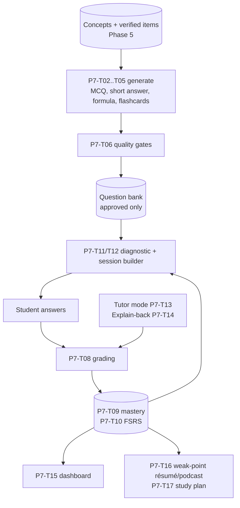

# Phase 7: Learning intelligence

**Goal:** go beyond producing content. **Measure what the student understands**, find what they struggle with, and **adapt** practice and revision to it. Activities: diagnostic quiz, multiple-choice (MCQ), short-answer questions, formula exercises, flashcards with spaced repetition, explain-back, and a Socratic tutor mode. All of it is built on the concept graph and the verified items from Phase 5.

**Estimate:** ~2 weeks · **Depends on:** Phase 5 (concepts + verified items)

**Phase done when:** you take the diagnostic quiz and two practice sessions as a test student, **deliberately getting 3 chosen concepts wrong**. The dashboard then shows exactly those concepts as weak, the next session focuses on them (and their prerequisites), and a manual review of 50 generated questions finds **> 90% correct and useful**.

---

## How it fits together



---

## Task list

| ID | Task | Est. |
|----|------|------|
| P7-T01 | Migration `008_learning.sql` + student profiles | 0.25 d |
| P7-T02 | MCQ generation | 0.75 d |
| P7-T03 | Short-answer questions + rubrics | 0.5 d |
| P7-T04 | Formula / application exercises | 0.75 d |
| P7-T05 | Flashcards from items | 0.25 d |
| P7-T06 | Quality gates | 1 d |
| P7-T07 | Question bank job | 0.5 d |
| P7-T08 | Grading | 1 d |
| P7-T09 | Learner model (mastery) | 0.75 d |
| P7-T10 | Spaced repetition (FSRS) | 0.5 d |
| P7-T11 | Diagnostic quiz | 0.5 d |
| P7-T12 | Session builder (next best activity) | 0.5 d |
| P7-T13 | Tutor mode (Socratic) | 0.75 d |
| P7-T14 | Explain-back activity | 0.5 d |
| P7-T15 | Mastery dashboard | 0.5 d |
| P7-T16 | Weak-point résumé + podcast | 0.25 d |
| P7-T17 | Study plan to exam date | 0.5 d |
| P7-T18 | Grade contest flow | 0.25 d |
| P7-T19 | Learn tab UI | 0.75 d |
| P7-T20 | Learning eval | 0.5 d |

**New requirements:** `fsrs` (check its API version; see P7-T10)

**New config:**
```yaml
learning:
  role_generate: chat
  role_gate: verifier
  role_grade: verifier
  questions_per_concept: {high: 6, medium: 4, low: 2}   # by importance ≥0.6 / ≥0.3 / else
  mcq_options: 4
  diagnostic_size: 12
  session_size: 10
  session_mix: {weak: 0.6, review_due: 0.2, unseen: 0.2}
  mastery:
    alpha: 0.3
    weight_correct: {1: 0.6, 2: 1.0, 3: 1.3}   # difficulty → weight when correct
    weight_wrong:   {1: 1.3, 2: 1.0, 3: 0.7}   # wrong on easy hurts more
    hint_penalty: 0.25
    decay_days: 30
    weak_below: 0.5
    strong_above: 0.8
  dedupe_similarity: 0.9
```

---

### P7-T01: Migration `008_learning.sql` + student profiles

```sql
CREATE TABLE students (
  id TEXT PRIMARY KEY,
  name TEXT NOT NULL,
  language TEXT NOT NULL DEFAULT 'fr',
  created_at TEXT NOT NULL
);

CREATE TABLE questions (
  id TEXT PRIMARY KEY,
  notebook_id TEXT NOT NULL,
  type TEXT NOT NULL,                  -- mcq | short | formula
  language TEXT NOT NULL,
  difficulty INTEGER NOT NULL,         -- 1 easy, 2 medium, 3 hard
  bloom TEXT NOT NULL,                 -- remember | understand | apply | analyze
  concept_ids_json TEXT NOT NULL,
  item_ids_json TEXT NOT NULL,         -- verified items it is based on
  stem TEXT NOT NULL,
  options_json TEXT,                   -- mcq: [{"key": "A", "text": "...", "why_wrong": "..."}]
  answer_json TEXT NOT NULL,           -- mcq: {"key": "B"}; short: {"model_answer": "..."}; formula: {"value": 12.5, "unit": "m/s", "tolerance": 0.01, "steps": [...]}
  rubric_json TEXT,                    -- short: [{"point": "...", "weight": 1, "item_id": "..."}]
  explanation TEXT NOT NULL,           -- shown after answering
  sources_json TEXT NOT NULL,
  status TEXT NOT NULL,                -- draft | approved | rejected | retired
  gate_json TEXT,                      -- results of the quality gates
  content_hash TEXT NOT NULL,
  created_at TEXT NOT NULL
);
CREATE INDEX idx_q_nb ON questions(notebook_id, status);

CREATE TABLE flashcards (
  id TEXT PRIMARY KEY,
  notebook_id TEXT NOT NULL,
  concept_id TEXT,
  item_id TEXT NOT NULL,
  language TEXT NOT NULL,
  front TEXT NOT NULL,
  back TEXT NOT NULL,
  created_at TEXT NOT NULL
);

CREATE TABLE fsrs_cards (
  student_id TEXT NOT NULL,
  flashcard_id TEXT NOT NULL REFERENCES flashcards(id) ON DELETE CASCADE,
  card_json TEXT NOT NULL,
  due_at TEXT NOT NULL,
  PRIMARY KEY (student_id, flashcard_id)
);

CREATE TABLE attempts (
  id TEXT PRIMARY KEY,
  student_id TEXT NOT NULL,
  notebook_id TEXT NOT NULL,
  activity TEXT NOT NULL,              -- diagnostic | practice | flashcard | explain | tutor
  question_id TEXT,
  flashcard_id TEXT,
  concept_ids_json TEXT NOT NULL,
  answer TEXT,
  score REAL NOT NULL,                 -- 0..1
  difficulty INTEGER,
  rubric_hits_json TEXT,
  misconceptions_json TEXT,
  feedback TEXT,
  hints_used INTEGER NOT NULL DEFAULT 0,
  duration_s REAL,
  created_at TEXT NOT NULL
);
CREATE INDEX idx_attempts_student ON attempts(student_id, notebook_id, created_at);

CREATE TABLE mastery (
  student_id TEXT NOT NULL,
  concept_id TEXT NOT NULL,
  mastery REAL NOT NULL,
  evidence REAL NOT NULL DEFAULT 0,
  attempts INTEGER NOT NULL DEFAULT 0,
  correct INTEGER NOT NULL DEFAULT 0,
  last_practiced TEXT,
  flags_json TEXT,                     -- e.g. {"asked_often": true, "misconceptions": [...]}
  updated_at TEXT NOT NULL,
  PRIMARY KEY (student_id, concept_id)
);

CREATE TABLE study_plans (
  id TEXT PRIMARY KEY,
  student_id TEXT NOT NULL,
  notebook_id TEXT NOT NULL,
  exam_date TEXT NOT NULL,
  minutes_per_day INTEGER NOT NULL,
  plan_json TEXT NOT NULL,
  created_at TEXT NOT NULL,
  updated_at TEXT NOT NULL
);

CREATE TABLE grade_contests (
  id TEXT PRIMARY KEY,
  attempt_id TEXT NOT NULL REFERENCES attempts(id),
  reason TEXT NOT NULL,
  status TEXT NOT NULL,                -- open | accepted | rejected
  resolution TEXT,
  created_at TEXT NOT NULL
);
```

**Student profiles (dev):** the sidebar gets a student selector + "new test student". In Phase 8 this comes from authentication.

---

### P7-T02: MCQ generation

**File:** `core/learning/questions.py`

**Input per concept:** the concept (names, short definition), its verified items (quotes, LaTeX, explanations), **neighbour concepts** from the graph (P5-T05 `neighbours()`) with their items, and the target difficulty and Bloom level.

**Output (JSON, validated):**
```json
{"stem": "…", "options": [{"key": "A", "text": "…", "why_wrong": "confond avec …"}, ...],
 "answer": {"key": "C"}, "explanation": "… [source]", "difficulty": 2, "bloom": "understand",
 "item_ids": ["i12"], "concept_ids": ["c3"]}
```

**Generation rules:**
- Exactly one correct option, supported by the cited items.
- **Distractors** come from (a) neighbour concepts (confusable notions), (b) common errors the text warns about (`pitfall` items), (c) plausible wrong values (wrong exponent, swapped variables). Each has a `why_wrong`, which is shown as feedback when chosen.
- No "all of the above" / "none of the above"; options of similar length; no negations in the stem unless highlighted (**ne… pas**).
- Difficulty: 1 = recall a definition; 2 = recognize an application or distinguish two concepts; 3 = combine two concepts or apply to a new case taken from the course.
- Language = the student's language. Quotes stay in the source language inside the explanation.

**Randomize the option order in code** (models tend to put the right answer in the same position) and store the shuffled key.

---

### P7-T03: Short-answer questions + rubrics

**Same file.**

```json
{"stem": "Explique le rôle de la chlorophylle dans la photosynthèse.",
 "model_answer": "…",
 "rubric": [{"point": "absorbe l'énergie lumineuse", "weight": 2, "item_id": "i14"},
            {"point": "principalement dans le rouge et le bleu", "weight": 1, "item_id": "i15"}],
 "difficulty": 2, "bloom": "understand"}
```

- 2–5 rubric points, each tied to a **verified item**. The total weight gives the max score.
- The model answer uses only rubric points.

---

### P7-T04: Formula / application exercises

**File:** `core/learning/exercises.py`

**Goal:** practice *using* a formula, with an answer computed by **code**, not by the LLM.

1. Start from a verified formula item whose LaTeX `sympy` can parse (P3-T07 helper), and whose variables (with units) are known.
2. The LLM (`chat`) proposes a short scenario in the course's context and chooses **which variable to solve for**, plus values for the others (realistic, with units). Output JSON: `{"scenario", "given": {"m": [2, "kg"], "v": [3, "m/s"]}, "unknown": "E"}`.
3. **Code** solves it: `sympy.solve(eq.subs(given), unknown)`, converts units if needed (keep the units consistent in v1; reject scenarios with mixed units), and rounds to 3 significant figures.
4. Steps: the formula, the substitution, the result (generated by code from the sympy expressions; the LLM only words the scenario).
5. Store `answer_json = {"value", "unit", "tolerance": 0.01 (relative), "steps"}`.

Skip formulas sympy can't parse. They still get MCQ and flashcards.

---

### P7-T05: Flashcards from items

**File:** `core/learning/flashcards.py`

Deterministic from verified items (no LLM needed, apart from optional translation):

| Item type | Front | Back |
|-----------|-------|------|
| definition | "Définis : {term}" / "Define: {term}" | the quote + source |
| formula | "Formule de {term} ?" / "Formula for {term}?" | LaTeX + variables + source |
| theorem / rule | "Énonce : {term}" / "State: {term}" | the quote |
| date | "Quand : {event}?" / "When: {event}?" | the date + quote |
| emphasis | "Point souligné par le prof : {term}" | the quote + `▶ mm:ss` |

`needs_check` items get flashcards too, with a ⚠️ on the back.

---

### P7-T06: Quality gates

**File:** `core/learning/gates.py`

Every generated question goes through these gates. Only **approved** questions reach students.

| Gate | How | Fail → |
|------|-----|--------|
| `schema` | Pydantic validation; MCQ has exactly 1 correct key; options unique | reject |
| `grounded` | Verifier: given the cited items only, is the correct answer supported? Is every factual claim in the stem and explanation supported? | reject |
| `blind_answer` | Verifier answers the question **without the answer key** (MCQ: picks an option; short: writes an answer, which is graded against the rubric). Must match the key (MCQ), or score ≥ 0.8 (short). | reject (ambiguous or wrong key) |
| `distractors` | MCQ: the verifier rates each distractor as plausible / implausible / also-correct. Any "also-correct" → reject. More than one "implausible" → regenerate the distractors once. | regenerate / reject |
| `not_trivial` | The stem doesn't contain the answer; the options aren't guessable by length or grammar (code: correct option length isn't an outlier; a French article/gender mismatch is checked by the verifier) | regenerate once |
| `dedupe` | Embedding similarity with approved questions on the same concept < `dedupe_similarity` | reject |
| `formula_numeric` | Formula exercises: recompute with sympy; check the value is finite and the units are consistent | reject |

Store all gate results in `gate_json`. Log the reject reasons, and show the rates in the eval (if > 40% of questions are rejected, the generation prompt needs work).

---

### P7-T07: Question bank job

**File:** `core/learning/jobs.py` → `@handler("question_bank")`

- Triggered after the concept/résumé items are available for a notebook (and again when documents change).
- Per concept: the target count from `questions_per_concept` by importance, spread across difficulties 1/2/3 and types (MCQ ~50%, short ~30%, formula when possible ~20%).
- Tasks: `gen:{concept}:{type}:{difficulty}` → `gate:{question_id}`. Runs in parallel, in the background, under the limiters.
- **Refill:** when a student has seen most approved questions of a concept, enqueue more for that concept.
- **Invalidation:** when an item a question cites changes or disappears (its section hash changed), set the question status to `retired`.

---

### P7-T08: Grading

**File:** `core/learning/grading.py`

```python
class Grade(BaseModel):
    score: float                    # 0..1
    rubric_hits: list[dict] = []    # [{"point": "...", "hit": true, "evidence": "student phrase"}]
    misconceptions: list[str] = []
    feedback: str                   # in the student's language; cites the course
    sources: list[Citation] = []

def grade_mcq(q, chosen_key) -> Grade               # deterministic; feedback = explanation + why_wrong of the chosen option
async def grade_short(q, answer, lang) -> Grade     # LLM + rubric
def grade_formula(q, value, unit) -> Grade          # numeric with tolerance; partial credit if correct but wrong unit/rounding
def grade_flashcard(rating: Literal[1, 2, 3, 4]) -> Grade   # again/hard/good/easy → 0 / 0.5 / 0.85 / 1
```

**Short-answer grader** (`verifier` role, temperature 0):
- Input: the question, rubric, cited item texts, and the student's answer.
- For each rubric point: hit / miss + the student phrase that shows it. Also list misconceptions (statements that contradict the items).
- `score = Σ weights of hits / Σ weights`, minus 0.25 per misconception (floor 0).
- Accept paraphrases and spelling mistakes, and accept answers in either language.
- Feedback: what was good, what's missing (with the course quote), and the misconception corrected.

**Show the rubric and the evidence** to the student after grading, with a "contest" button (P7-T18).

---

### P7-T09: Learner model (mastery)

**File:** `core/learning/learner_model.py`

**State per (student, concept):** `mastery m ∈ [0,1]` (starts at 0.3 when evidence = 0, but is **displayed as "not yet practiced"**, never as weak), `evidence`, `attempts`, `correct`, `last_practiced`, `flags`.

**Update after each graded attempt**, for every concept of the question (split the weight equally if there are several):
```
s = score × (1 − hint_penalty × hints_used)            # clamp ≥ 0
w = weight_correct[difficulty] if s ≥ 0.5 else weight_wrong[difficulty]
m ← m + alpha × w × (s − m)                            # clamp to [0, 1]
evidence ← evidence + w
```
Why this rule: it's simple, explainable and stable. Correct answers on hard questions raise mastery more; mistakes on easy questions lower it more. You can later replace it with Bayesian Knowledge Tracing behind the same interface.

**Effective mastery (for display and scheduling):** `m_eff = m × exp(−days_since_last_practice / decay_days)`, so material not reviewed for a long time slowly returns to the "to review" level.

**Prerequisite propagation:** when a concept's score is < 0.5 and one of its prerequisites has low evidence (< 1) or `m_eff < weak_below`, add `{"check_prerequisite": prereq_id}` to the flags. The session builder schedules the prerequisite first.

**Chat signal (weak):** the chat engine logs the concepts behind each question (via retrieved chunks' `concept_ids`). If the student asks about the same concept ≥ 3 times in 7 days, set `flags.asked_often = true`. This **doesn't** change mastery (asking questions isn't failing). It raises the concept's priority in the next session.

**Explain-back misconceptions** go to `flags.misconceptions` (shown on the dashboard, used by tutor mode).

**Tests:** a sequence of scores produces the expected values; a wrong answer on an easy question lowers mastery more than one on a hard question; hints reduce the gain; decay works.

---

### P7-T10: Spaced repetition (FSRS)

**File:** `core/learning/scheduler.py`

- Use the `fsrs` package. **Check the installed version's API**: recent versions use `Scheduler`, `Card` and `Rating` with `scheduler.review_card(card, rating)`; older ones use `FSRS().repeat(...)`. Wrap it so the rest of the code doesn't depend on the version.
- New flashcards are created per student lazily, when first shown.
- Store `card_json` (the card's state) and `due_at`.
- A flashcard rating also updates **mastery** of its concept (P7-T08 mapping, difficulty 1).
- `due_cards(student, notebook, limit)` returns cards due now, oldest first.

---

### P7-T11: Diagnostic quiz

**File:** `core/learning/session.py`

**Goal:** a first estimate of mastery across the main concepts in ~10 minutes.

- Pick the top `diagnostic_size` concepts by importance, covering every topic (round-robin over topics).
- One MCQ per concept, starting at difficulty 2.
- **Light adaptivity per topic:** correct → the next question in that topic is difficulty 3; wrong → difficulty 1.
- Show results at the end: per topic, the concepts that look solid, look weak, or weren't tested. Then a call to action: "Commencer une séance ciblée" ("Start a targeted session").

---

### P7-T12: Session builder (next best activity)

**Same file.**

```python
def build_session(student_id, notebook_id, size=None) -> list[Activity]:
```

1. **Candidate concepts** with priority:
   `priority = importance × (1 − m_eff) × (1 + 0.5 × asked_often) × (1.3 if evidence < 1 else 1)`
2. **Prerequisites first**: if a candidate has the `check_prerequisite` flag, insert the prerequisite before it.
3. **Mix** by `session_mix`: 60% weak concepts (`m_eff < weak_below`, highest priority), 20% due flashcards (FSRS), 20% unseen concepts (evidence = 0, by importance).
4. **Per concept, pick an activity**: low mastery → MCQ difficulty 1–2 or a flashcard; medium → short answer or MCQ 2–3; high but decaying → a formula exercise or a difficulty-3 question. Never repeat the same question within 3 days.
5. Interleave topics. Don't put two activities on the same concept back to back.

At the end of a session, show a summary: what improved, what's still weak, and suggestions (tutor mode on concept X, re-read section Y of the résumé).

---

### P7-T13: Tutor mode (Socratic)

**File:** `core/chat/tutor.py` (used by the Chat tab mode switch and by the "Revoir avec le tuteur" / "Review with the tutor" button after a wrong answer)

**Behaviour:** guide the student to the answer instead of giving it right away.

State per tutor conversation: `concept_id`, `target_items`, `hint_level` (0–3), `turns`.

1. Start: ask the student what they already know about the concept (or start from their wrong answer and its misconception).
2. Each student message → the tutor LLM (`chat`), with the concept's verified items and chunks as sources:
   - Judge the message: correct / partially correct / misconception.
   - If not yet correct: give the next **hint level**. Level 1: a guiding question. Level 2: point to the relevant part of the course (cite it). Level 3: a partial answer. After level 3: the full explanation with citations.
   - If correct: confirm, add one deeper question or a related concept (from the graph), and end.
3. Record an attempt (`activity="tutor"`) at the end: score = 1 if solved with ≤ 1 hint, 0.7 with 2, 0.4 with 3, 0.2 if the explanation was given. `hints_used` = the hint level reached.

Same grounding rules as chat: only the course sources, with citations.

---

### P7-T14: Explain-back activity

**File:** `core/learning/explain_back.py`

- Prompt: "Explique {concept} avec tes propres mots, comme si tu l'expliquais à un camarade." ("Explain {concept} in your own words, as if you were explaining it to a classmate.") The student can type, or **record** (`st.audio_input` → Phase 4 ASR).
- Grading: a rubric built automatically from the concept's verified items (definition + 2–4 key points, weighted). Same grader as P7-T08, with special attention to **misconceptions** (contradictions with the items) and **missing key points**.
- Feedback: what was correct; what's missing (quote the course); misconceptions corrected. Offer tutor mode on that concept.

---

### P7-T15: Mastery dashboard

**File:** `assistant/app/tab_learn.py` (dashboard section)

- **Heatmap / grid**: concepts grouped by topic (course order). Colour = `m_eff` (red < 0.5, orange 0.5–0.8, green > 0.8). **Grey = not yet practiced** (don't show unknown as weak).
- Per concept (click): mastery history (line chart over attempts), recent attempts with feedback, misconceptions, flags, due flashcards, buttons "practice this", "tutor", "view in résumé".
- **Summary cards**: concepts mastered / to review / not started; flashcards due today; streak (optional).
- Wording: "à revoir" / "maîtrisé" ("to review" / "mastered"). **Never** a grade or score out of 20.

---

### P7-T16: Weak-point résumé + podcast

- Résumé job (P5-T16) with `focus_weak=true`: the scope = concepts with `m_eff < weak_below` or with misconceptions (plus their prerequisites). Include the "🎯 Tes points faibles" section: each weak concept with its key items, the student's typical mistake (from misconceptions / `why_wrong` of chosen distractors), and a suggested exercise.
- Podcast job (P6-T04) with `focus_weak=true`: `PodcastPack.weak_concepts` gets these concepts first, and the script prompt adds "insist on the common mistakes: …".
- **Cache keys include the weak-concept set**, so regenerating after progress gives a new artifact.

---

### P7-T17: Study plan to exam date

**File:** `core/learning/plan.py`

Inputs: exam date, minutes per day, and days off (optional).

1. **Workload per concept**: `need = importance × (1 − m_eff)`, plus a review slot for every concept (even strong ones) in the last 3 days.
2. **Ordering**: follow the course order, with prerequisites before dependants (topological order of the prerequisite graph).
3. **Spacing**: each weak concept gets practised at least 2–3 times with growing gaps (e.g. day d, d+2, d+5), and flashcard reviews are added daily (estimated from FSRS due dates).
4. **Daily budget**: pack activities into `minutes_per_day` (estimates: MCQ 1 min, short answer 3 min, formula 4 min, flashcard 0.3 min, tutor 8 min, résumé reading 5 min per topic).
5. **Last day**: the cheat-sheet résumé + the podcast (short) + flashcards on the weakest concepts.
6. **Re-plan** automatically after each session (mastery changed) and show what moved.

Output: `plan_json = [{"date": "...", "items": [{"concept_id", "activity", "minutes"}]}]`, shown as a calendar/list with a "start today's session" button.

---

### P7-T18: Grade contest flow

- After any LLM-graded answer: "Je pense que ma réponse est correcte" ("I think my answer is correct") + a reason field → a `grade_contests` row.
- **Automatic second opinion**: re-grade with the `chat` model (a different family from the grader) and show both. If the second grading gives a higher score, accept it automatically, update the attempt and recompute mastery from the attempt history.
- Contests that remain open are listed in the dev UI for you to resolve, and they're used to improve the grading prompt.

---

### P7-T19: Learn tab UI

**File:** `assistant/app/tab_learn.py`

Sub-sections:
1. **Commencer** (start): the diagnostic quiz if there's no evidence yet, otherwise "Today's session" (from the study plan or the session builder).
2. **Séance** (session): one activity at a time, with the right input (MCQ radio buttons, a text area, a numeric input with unit, flashcard flip + 4 rating buttons, an audio input for explain-back). Then immediate feedback with sources, and a "tutor" button when wrong. Progress bar for the session.
3. **Flashcards**: due cards only, or browse by concept.
4. **Tableau de bord** (dashboard, P7-T15).
5. **Plan** (P7-T17).
6. **Dev tools**: question bank browser (filter by concept, type, status; gate results; approve/reject by hand), contested grades, a "reset this student's data" button.

---

### P7-T20: Learning eval

**Files:** `assistant/eval/learning/`

1. **Question quality**: sample 50 approved questions (spread over types and difficulties) and review them by hand in the dev tools: correct? clear? useful for the exam? distractors plausible? Target > 90% correct and useful. Also record the gate reject rate per type.
2. **Grader agreement**: write 30 short answers yourself (good, partial, wrong, with misconceptions, in FR and EN), grade them yourself, and compare with the LLM grader. Target: same verdict band (wrong / partial / correct) on ≥ 85%, and **no** case where the grader marks a wrong answer as correct.
3. **Simulated learner** (automated test): a script plays a "student" who answers correctly except on 3 chosen concepts (always picks a distractor, or answers the short questions with a known misconception). After the diagnostic + 2 sessions, assert that those 3 concepts are the lowest in mastery, and that session 3 contains them (or their prerequisites) in ≥ 60% of its activities.
4. **Unit tests**: mastery update rule, decay, session mix proportions, prerequisite-first ordering, FSRS wrapper, MCQ option shuffle keeps the right key, formula exercise solving.

---

## Phase 7 checklist

- [ ] P7-T01 migration + students
- [ ] P7-T02 MCQ
- [ ] P7-T03 short answer + rubrics
- [ ] P7-T04 formula exercises
- [ ] P7-T05 flashcards
- [ ] P7-T06 quality gates
- [ ] P7-T07 question bank job
- [ ] P7-T08 grading
- [ ] P7-T09 mastery
- [ ] P7-T10 FSRS
- [ ] P7-T11 diagnostic
- [ ] P7-T12 session builder
- [ ] P7-T13 tutor mode
- [ ] P7-T14 explain-back
- [ ] P7-T15 dashboard
- [ ] P7-T16 weak-point artifacts
- [ ] P7-T17 study plan
- [ ] P7-T18 contests
- [ ] P7-T19 Learn tab
- [ ] P7-T20 eval
- [ ] **P7-UI** Student interface: `quiz`, `flashcards`, `record_answer` and the mastery data come from the learning engine; add the study plan and tutor mode.
- [ ] **Acceptance:** the 3 deliberately failed concepts show as weak and drive the next session; > 90% of reviewed questions are correct and useful
