# Study Assistant: Project Plan

> A NotebookLM-style study assistant for the E-learning platform. Students upload their course material (PDFs, images, text, Markdown, teacher audio recordings, and more). They can then chat with it in **French or English**, get a **verified exam-night summary**, listen to a **podcast-style audio summary**, and **practice with quizzes and flashcards** that track which concepts they've mastered and which they struggle with.

---

## 1. Overview

### 1.1 Goals

| # | Goal | What it means in practice |
|---|------|---------------------------|
| G1 | **Multi-format ingestion** | PDF (digital, scanned, and **digital with images that contain text**), images (photos of the board, handwritten notes, slides), TXT, Markdown, DOCX/PPTX, audio (teacher recordings) |
| G2 | **Bilingual (FR / EN)** | Documents can be in either language or mixed. The student can ask in either language. Answers come back in the student's language. |
| G3 | **Accurate, grounded chat** | Every answer is based on the student's documents and cites its sources (file, page, or audio timestamp). If the answer isn't in the material, the bot says so. |
| G4 | **Verified exam-night summary ("Résumé")** | A structured, detailed, complete revision sheet. **Definitions and formulas are checked against the source, section by section.** |
| G5 | **Audio podcast** | A two-host conversational audio summary of the material |
| G6 | **Learning intelligence** | Know what the student understands and where they struggle: diagnostic quizzes, flashcards, a mastery score per concept, and revision focused on weak concepts |
| G7 | **Fast and responsive** | Parallel processing, caching and progress tracking from day one. Chat becomes usable while slow extraction (OCR, audio) is still running. |
| G8 | **Free models only** | All LLM, VLM, OCR, ASR, embedding and TTS calls go through **NVIDIA Build** (`build.nvidia.com`) free endpoints. Local open-source tools fill the gaps. |
| G9 | **Dev test UI** | A Streamlit app for you only, used to test every stage of the pipeline |

### 1.2 Non-goals (for now)
- A production multi-user backend, auth, or billing. That's Phase 8, when it gets integrated into the E-learning platform.
- Fine-tuning models.
- Video files. Their audio track can be extracted and treated as audio later.

### 1.3 Design decisions on the initial ideas

| Idea | Decision |
|------|----------|
| Classify each file, then run a dedicated pipeline per type | ✅ **Keep.** Every pipeline outputs the **same intermediate format** (§5.1), so everything after ingestion doesn't care where the content came from. |
| YOLO for images | ❌ **Not the right tool.** YOLO detects objects ("there is a person, a chair"). It doesn't *read* or *understand* study material. Use **OCR + a Vision-Language Model (VLM)**. They read text, formulas, diagrams and handwriting, and describe what they see. |
| PyMuPDF alone for PDFs | ❌ **Not enough.** It only reads the text layer. It misses text inside images (screenshots, scanned figures, slides pasted as pictures), text drawn as vector shapes, and complex tables. The PDF pipeline (§5.3) analyses **every page and every embedded image** and sends anything with hidden text to OCR. A local "missed-text detector" catches the cases the analysis misses. |
| Graph database vs vector database | **Vector + keyword (hybrid) search + a reranker** for chat. A full GraphRAG costs a lot of LLM calls, which is painful with free-tier rate limits. A **concept graph** is still built (§8.1), because learning intelligence needs it: concepts, their prerequisites, and which chunks teach them. |
| Use RAG to build the summary | ⚠️ **No.** RAG retrieves the top-k chunks, so it *drops* content by design. The summary uses **map-reduce over all chunks** (§7.1) **plus section-level verification**. RAG is for *chat*. |
| Redis vs SQLite | **SQLite now, Redis in Phase 8.** They do different jobs. See §2.6. |

---

## 2. System architecture

### 2.1 High-level view

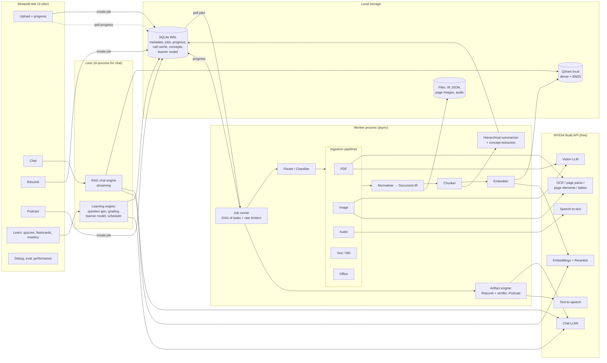

### 2.2 Key design principles
1. **Keep the core independent of any UI.** All logic lives in the `core/` package. Streamlit calls `core` directly for fast operations (chat, quizzes) and **submits jobs** for slow ones (ingestion, résumé, podcast). A FastAPI service will wrap the same `core` later.
2. **Slow work runs in a separate worker process**, never inside a Streamlit rerun. The UI stays responsive and only polls progress. That's the same shape as a production Redis/Celery setup, so moving to it later is easy (§2.6).
3. **Performance from day one** (§3): async provider calls with per-model rate limiters, parallel page/chunk tasks, multi-level caching, progressive availability, and progress tracking.
4. **One provider interface.** Every model call goes through `core/providers/`. Swap a model (or move off NVIDIA) by changing config, not code.
5. **Every piece of content keeps its source.** Blocks, chunks, summary items and quiz questions all carry `doc_id`, `page` / `timestamp`, `section_path`, `language`, `extractor`, `confidence` and `concept_ids`. That's what makes citations, verification and mastery tracking possible.
6. **Verify, don't trust.** LLM output that the student will learn from (definitions, formulas, quiz answers) goes through deterministic checks first and an LLM verifier second.
7. **Notebooks (collections).** As in NotebookLM, a student groups files into a notebook (one per course or subject). Retrieval is always scoped to one notebook.

### 2.3 Tech stack

| Layer | Choice | Why |
|-------|--------|-----|
| Language | **Python 3.13** | Best ecosystem for this. Installed on the dev machine; 3.10 reaches end-of-life in October 2026. |
| Env | **`venv`** + `requirements.txt` (pinned) | Your requirement. Simple. |
| UI (dev) | **Streamlit** (≥ 1.37 for `st.fragment(run_every=...)`) | Fast test interface; fragments refresh progress without rerunning the whole page |
| LLM client | **`openai` SDK, `AsyncOpenAI`**, pointed at `https://integrate.api.nvidia.com/v1` | NVIDIA Build endpoints are OpenAI-compatible; async lets dozens of calls run concurrently |
| Concurrency | **`asyncio`** + **`aiolimiter`** (requests/min) + `asyncio.Semaphore` (in-flight calls) + `ProcessPoolExecutor` (CPU work) | The bottleneck is API rate limits and I/O, not CPU |
| Retries | **`tenacity`** | Backoff on 429/5xx |
| Speech (ASR/TTS) | **`nvidia-riva-client`** (gRPC to NVIDIA cloud functions) | NVIDIA's speech models are served through Riva |
| PDF | **PyMuPDF** (`pymupdf`, `pymupdf4llm`) for page analysis, text layer, image extraction and rendering, **+ NVIDIA OCR / page-parse models** for anything visual | See §5.3 |
| Local OCR (missed-text detector, fallback) | **`rapidocr-onnxruntime`** (pip-only, CPU) | Cheap local check; no system install |
| Office | **Docling** (or `python-docx` / `python-pptx`) | Structure-preserving conversion to Markdown |
| Audio tooling | **ffmpeg** + `pydub`, **silero-vad** | Format conversion, voice-activity-based chunking |
| Language detection | **`lingua-language-detector`** | Accurate on short FR/EN text |
| Vector DB | **Qdrant** (local mode via `qdrant-client`) | Dense + sparse (BM25) hybrid search, metadata filters, no server needed |
| Metadata, jobs, cache, learner model | **SQLite** in WAL mode | Durable, zero setup, safe for one worker + UI readers (§2.6) |
| Verification helpers | **`rapidfuzz`** (fuzzy quote matching), **`sympy`** (formula/numeric checks) | Deterministic checks before any LLM judge |
| Concept graph | **`networkx`** (graph stored in SQLite tables) | Light; no graph DB server needed |
| Spaced repetition | **`fsrs`** | Modern, open-source flashcard scheduling algorithm |
| Orchestration | **Plain Python** (no LangChain at first) | Full control, easy debugging |
| Validation | **Pydantic v2** | Typed IR, configs, and structured LLM outputs |
| Eval | **Custom eval script** (+ optional `ragas`) | Measure accuracy, not guess it |
| Future API | **FastAPI** + **Redis** queue + **Postgres** | Phase 8 |

### 2.4 NVIDIA Build models (candidates)

> ⚠️ The NVIDIA catalog changes often. **Check each model ID at `build.nvidia.com` before using it**, and keep IDs in `config.yaml`, never hard-coded. The free API is meant for **development and prototyping**. Check NVIDIA's terms before serving real students, and plan for rate limits (around 40 requests/min per model is typical). The rate limits are why §3 matters so much.

| Role | Primary candidate | Fallback | Notes |
|------|-------------------|----------|-------|
| Chat / reasoning LLM | `nvidia/llama-3.3-nemotron-super-49b-v1.5` | `meta/llama-3.3-70b-instruct`, `mistralai/mistral-large-*`, `qwen/*` | Must be strong in **French**. Test each on your own FR material (Phase 2 eval). |
| Verifier LLM | A **different model family** from the writer | | Two different models make different mistakes, so cross-checking catches more |
| Fast / cheap LLM (cleanup, classification, map step) | `meta/llama-3.1-8b-instruct` | `nvidia/nemotron-mini-*` | High-volume steps |
| Vision LLM (images, figures) | `meta/llama-3.2-90b-vision-instruct` | `meta/llama-4-maverick-*`, `microsoft/phi-4-multimodal-instruct` | Describes diagrams, reads slides and handwriting |
| Page parsing (scanned pages → Markdown) | `nvidia/nemoretriever-parse` | VLM page transcription | Structured Markdown incl. tables |
| Page layout / elements | `nvidia/nemoretriever-page-elements-*`, `nvidia/nemoretriever-table-structure-*`, `nvidia/nemoretriever-graphic-elements-*` | PyMuPDF heuristics, `page.find_tables()` | Locates tables, charts and text regions on a page |
| OCR | `nvidia/nemoretriever-ocr-v1` / `baidu/paddleocr` | Local **RapidOCR** / PaddleOCR / Tesseract (`fra+eng`) | Text inside images |
| Embeddings (multilingual) | `nvidia/llama-3.2-nemoretriever-300m-embed-v1` or `nvidia/llama-3.2-nv-embedqa-1b-v2` | `baai/bge-m3` | **Must be multilingual** so a French question finds English content and vice versa |
| Reranker | `nvidia/llama-3.2-nv-rerankqa-1b-v2` | local `bge-reranker-v2-m3` | Large accuracy gain for a small cost |
| ASR (speech-to-text) | `openai/whisper-large-v3` (Riva) | `nvidia/canary-1b` (multilingual), local `faster-whisper` | Whisper handles FR/EN and auto-detects the language |
| TTS (podcast) | `nvidia/magpie-tts-multilingual` (Riva) | Local **Piper** (FR + EN voices) or `edge-tts` | Need **two distinct voices per language** |

> **Reference to study:** NVIDIA's open-source **NeMo Retriever extraction** (formerly *NV-Ingest*) pipeline does exactly this kind of PDF extraction (page elements → tables/charts/OCR) with the models above. Read its design before building §5.3. It's heavy to self-host, but its approach is worth copying.

### 2.5 Communication between components

| From → To | Protocol | Payload |
|-----------|----------|---------|
| Streamlit → core (chat, quizzes) | Direct Python calls | Query, notebook ID; answers **stream** token by token |
| Streamlit → worker (ingest, résumé, podcast) | Insert a row into the `jobs` table (SQLite) | Job type + parameters |
| Worker → Streamlit (progress) | Worker writes `tasks` / `jobs` rows; Streamlit polls them every 1–2 s with `st.fragment(run_every=...)` | Stage, done/total, ETA, errors |
| core → NVIDIA LLM, VLM, OCR, embed, rerank | HTTPS REST (OpenAI-compatible or NIM JSON), `Authorization: Bearer $NVIDIA_API_KEY` | JSON. Images as base64. |
| core → NVIDIA ASR/TTS | gRPC (`grpc.nvcf.nvidia.com:443`) with `function-id` + API-key metadata | Audio bytes / text (run in threads; client is synchronous) |
| core → Qdrant | HTTP to the local server (`QdrantClient(url="http://localhost:6333")`) | Vectors + payload |
| core → SQLite | In-process, WAL mode | Metadata, jobs, cache, learner model |

> **Qdrant runs as a small local server** (Docker, or the `qdrant.exe` Windows binary from Qdrant's GitHub releases). Qdrant's embedded "local mode" lets only one process open its folder, and here both the worker (writes) and the UI (chat reads) need it. Use embedded mode only in unit tests (`QdrantClient(":memory:")`).

### 2.6 Storage: why SQLite now and not Redis

They are different tools:

| | **SQLite** | **Redis** |
|---|---|---|
| What it is | A database **file**, accessed in-process | An **in-memory server** you must run separately |
| Durability | Durable by default | Memory-first; persistence must be configured |
| Strengths | Relational data, queries, joins, history | Very fast key/value cache, queues, pub/sub **shared between many machines/workers** |
| Windows | Built into Python | No official native build: needs Docker/WSL (or Memurai). **RQ** doesn't run on Windows (it uses `fork`). Celery on Windows needs the `solo`/`threads` pool. |

What this project stores in phases 0–7:
- **Expensive results that must survive restarts**: OCR of a 200-page PDF, transcripts, LLM summaries. These are worth keeping for weeks. → durable store (SQLite), not a memory cache.
- **Relational data**: notebooks → documents → pages → chunks → concepts → quiz attempts → mastery. → a SQL database.
- **Job queue + progress** for **one** worker on **one** machine. → a SQLite `jobs` table is enough.

When Redis **does** become worth it (Phase 8): several API servers and workers on different machines need a **shared queue**, **shared hot cache**, **cross-process rate limiting**, and **live progress via pub/sub**. At that point: Redis for queue/cache/rate limits, **Postgres** for durable data (it replaces SQLite, not Redis).

To make that move painless, the code uses three small interfaces from day one:
- `JobQueue` (`enqueue`, `claim`, `update_progress`): SQLite now, Redis/Celery later
- `CallCache` (`get`, `set`): SQLite now, Redis + Postgres later
- `RateLimiter`: in-process now, Redis-backed later

If you still want Redis now (for example to practice with it), run it in Docker and implement `CallCache` with it. Nothing else changes.

---

## 3. Performance and concurrency (from day one)

### 3.1 Where the time goes

| Stage | Bottleneck | Strategy |
|-------|-----------|----------|
| PDF page analysis, rendering, local OCR check | CPU | `ProcessPoolExecutor`, one task per page |
| OCR / page parse / VLM | API rate limit + network latency | Async calls, per-model limiter, only pages/images that need it |
| ASR | API rate limit, audio length | VAD chunks of ≤ 30 s transcribed in parallel |
| Embeddings | Number of requests | **Batch** 32–64 texts per request; cache by text hash |
| Summaries, map step | Number of LLM calls | Fast model for map, strong model only for reduce; parallel per section |
| Chat answer | LLM generation time | **Stream tokens**; rerank and retrieval run in parallel per query variant |

### 3.2 Execution model

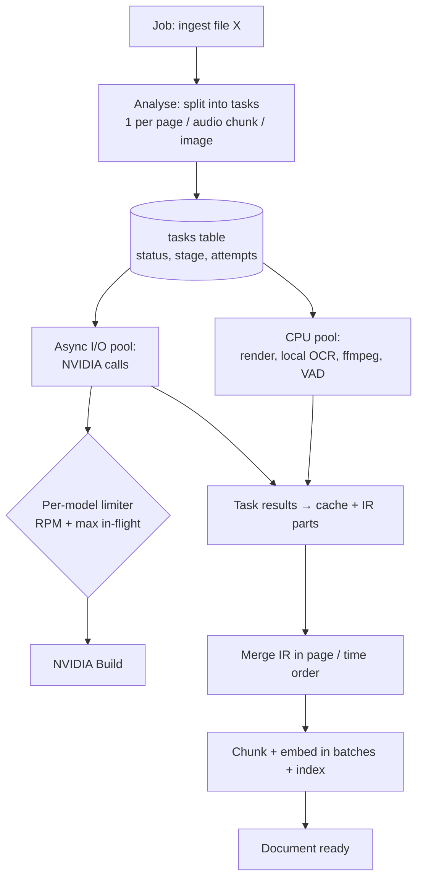

- **Worker process**: `python -m assistant.worker` runs an asyncio event loop. It claims jobs from SQLite and runs their tasks concurrently.
- **Per-model limits** in `config.yaml`, for example `rpm: 35, max_in_flight: 8`. Stay a bit below the real limit to avoid 429 storms.
- **Priorities**: chat and quiz calls (interactive) get their own limiter budget so a background ingestion never blocks the student. For example, keep 20% of each model's RPM for interactive use.
- **Resumable**: each task's result is saved as soon as it finishes. A crash or restart only redoes unfinished tasks.
- **Graceful degradation**: if a model keeps failing, use the fallback in config and record it in the block's `extractor` field and in IR warnings.

### 3.3 Progressive availability

A document doesn't have to be 100% processed before the student can use it:

1. **Text-layer pages** (instant) are chunked and indexed first. Chat already works on them.
2. **OCR / VLM pages and images** are indexed as they complete. The UI shows "12/40 pages enriched".
3. **Section and document summaries** and **concept extraction** run last, in the background.

Chat answers include a note when relevant sources are still processing: *"3 pages de ce document sont encore en cours d'analyse"* ("3 pages of this document are still being analysed").

### 3.4 Caching layers

| Level | Key | What it saves |
|-------|-----|---------------|
| File | SHA-256 of the file | Re-uploading the same file is instant (dedup per notebook; extraction reused across notebooks) |
| Page / image / audio chunk | hash(content bytes + extractor + version) | OCR, parse, VLM, ASR results |
| LLM call | hash(model + messages + params) | Any repeated prompt (great during development) |
| Embedding | hash(model + text) | Re-indexing after a chunking change only embeds changed chunks |
| Artifact | hash(notebook content version + options) | Résumé/podcast regenerate only when sources or options change |

Each cache entry stores a `pipeline_version`. Bumping the version of one extractor invalidates only its entries.

### 3.5 Progress tracking

- Tables: `jobs(id, type, status, created_at, started_at, finished_at, error)` and `tasks(id, job_id, kind, status, stage, attempts, duration_ms, error)`.
- The UI shows per file: current stage, `done/total` tasks, estimated time left (from the average task duration), and a retry button for failed tasks.
- A **Performance** panel shows the time per stage, cache hit rate, API calls per model, and 429 counts.

### 3.6 Target budgets (adjust after measuring)

| Operation | Target |
|-----------|--------|
| Chat: time to first token | < 3 s |
| Digital 50-page PDF → chat-ready | < 1 min |
| Scanned page | Limited by OCR RPM (≈ 35 pages/min at 35 RPM) |
| 1-hour lecture audio | < 10 min (parallel chunks) |
| Résumé for a 300-page notebook | Background job, minutes; progress shown per section |

---

## 4. Project structure

```
E-learning/
├── docs/
│   └── study-assistant-plan.md        ← this file
├── assistant/
│   ├── core/
│   │   ├── config.py                  # loads config.yaml + .env
│   │   ├── models.py                  # Pydantic: DocumentIR, Block, Chunk, Citation, Concept...
│   │   ├── db.py                      # SQLite (WAL) schema + access
│   │   ├── runtime/
│   │   │   ├── queue.py               # JobQueue interface + SQLite implementation
│   │   │   ├── limiter.py             # per-model RPM + in-flight limits, priorities
│   │   │   ├── cache.py               # CallCache interface + SQLite implementation
│   │   │   ├── progress.py            # task/job progress, ETA
│   │   │   └── metrics.py             # timings, cache hits, API counts
│   │   ├── providers/
│   │   │   ├── llm.py                 # chat(), chat_json(), stream()
│   │   │   ├── vision.py              # describe_image(), transcribe_page()
│   │   │   ├── ocr.py                 # NVIDIA OCR / page parse / page elements; RapidOCR local
│   │   │   ├── embeddings.py          # batched embed_passages(), embed_query()
│   │   │   ├── rerank.py
│   │   │   ├── asr.py                 # Riva / faster-whisper
│   │   │   └── tts.py                 # Riva Magpie / Piper
│   │   ├── ingestion/
│   │   │   ├── router.py
│   │   │   ├── pdf/
│   │   │   │   ├── analyze.py         # per-page analysis + classification
│   │   │   │   ├── text_layer.py      # PyMuPDF text, tables
│   │   │   │   ├── images.py          # embedded image extraction, dedup, OCR/VLM
│   │   │   │   ├── scanned.py         # full-page parse / OCR / VLM
│   │   │   │   ├── missed_text.py     # local OCR safety net
│   │   │   │   └── merge.py           # reading order, headers/footers
│   │   │   ├── image.py
│   │   │   ├── audio.py
│   │   │   ├── text.py
│   │   │   ├── office.py
│   │   │   └── normalize.py
│   │   ├── indexing/
│   │   │   ├── chunker.py
│   │   │   ├── store.py               # Qdrant wrapper (hybrid)
│   │   │   ├── summaries.py           # hierarchical summaries
│   │   │   └── concepts.py            # concept extraction + graph
│   │   ├── chat/
│   │   │   ├── retriever.py
│   │   │   ├── engine.py              # grounded streaming answers + citations, tutor mode
│   │   │   └── prompts.py
│   │   ├── artifacts/
│   │   │   ├── resume/
│   │   │   │   ├── inventory.py       # required items per section
│   │   │   │   ├── map.py
│   │   │   │   ├── verify.py          # deterministic + LLM verification
│   │   │   │   ├── reduce.py
│   │   │   │   └── report.py          # coverage / verification report
│   │   │   ├── podcast.py
│   │   │   └── prompts.py
│   │   └── learning/
│   │       ├── questions.py           # question generation + quality gates
│   │       ├── grading.py             # MCQ, short answer, formula
│   │       ├── learner_model.py       # mastery per concept
│   │       ├── scheduler.py           # FSRS flashcards + next best activity
│   │       └── plan.py                # study plan to exam date
│   ├── worker.py                      # python -m assistant.worker
│   ├── app/
│   │   └── streamlit_app.py
│   ├── eval/
│   │   ├── datasets/
│   │   └── run_eval.py
│   ├── tests/
│   ├── config.yaml
│   ├── requirements.txt
│   └── .env.example
├── data/                              # git-ignored
└── .gitignore
```

---

## 5. Ingestion: the per-type pipelines

### 5.1 The common output: Document IR (intermediate representation)

```python
class Block(BaseModel):
    type: Literal["heading", "paragraph", "list", "table", "formula",
                  "figure_description", "image_text", "transcript_segment", "code"]
    text: str                      # Markdown text (LaTeX for math)
    level: int | None = None       # heading level
    page: int | None = None        # PDF/office page or slide number
    bbox: tuple | None = None      # position on the page → reading order + highlighting
    start_s: float | None = None   # audio timestamps
    end_s: float | None = None
    extractor: str                 # "pymupdf", "nemoretriever-ocr", "nemoretriever-parse", "vlm", "whisper"...
    confidence: float | None = None
    verified_by: list[str] = []    # second extractor that agreed (used for formulas)
    important: bool = False        # teacher emphasis, "à retenir" boxes...

class DocumentIR(BaseModel):
    doc_id: str
    notebook_id: str
    filename: str
    kind: Literal["pdf", "image", "audio", "text", "markdown", "docx", "pptx"]
    language: Literal["fr", "en", "mixed", "unknown"]
    title: str | None
    blocks: list[Block]
    page_reports: list[PageReport] # per-page class, extractors used, timings
    warnings: list[str]
```

The IR is saved as `data/ir/<doc_id>.json`. The Streamlit IR viewer shows **the page image next to the extracted blocks**, so you can spot extraction errors at a glance. Most accuracy problems start here.

### 5.2 Step 0: Router / classifier

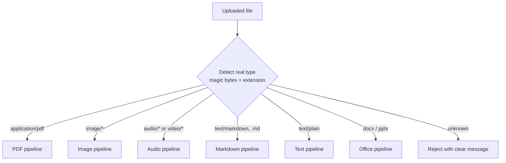

- Detect the type from the **file content** (`filetype` package), not just the extension.
- **SHA-256** for dedup and caching.
- Limits (for example 100 MB per file, 3 h audio) so one upload can't burn the free quota.

### 5.3 PDF pipeline (the most important one)

PyMuPDF alone reads only the **text layer**. Real course PDFs also contain:
- **images with text** (screenshots of code or slides, scanned figures, pasted photos of tables),
- **fully scanned pages**,
- **text drawn as vector shapes** (looks like text, has no text layer),
- **complex tables and formulas**, often rendered as images.

So every page is **analysed first** (cheap, local), then each part goes to the right extractor.

#### Step A: page analysis (local, CPU, parallel per page)

For each page, PyMuPDF collects:
- `text_chars` and a `garbage_ratio` (share of `�`, control characters, broken encodings)
- **Embedded images** with their position and size (`page.get_image_info(xrefs=True)`), and the share of the page they cover
- **Vector drawing density** (`page.get_drawings()`): diagrams, or text drawn as shapes
- Candidate **tables** (`page.find_tables()`)

Embedded images are **deduplicated** by content hash. Images that repeat on most pages (logos, headers) and tiny images (< 64 px) are skipped.

#### Step B: page classification and routing

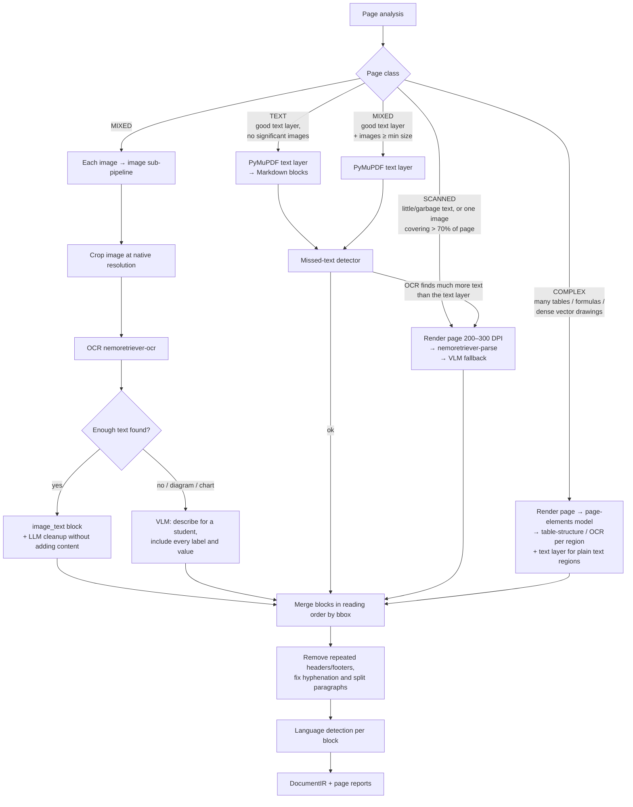

#### Step C: missed-text detector (the safety net)

The rules in step B can't catch everything (text drawn as shapes, small screenshots, odd PDF generators). So every TEXT/MIXED page also gets a cheap **local check**:

1. Render the page at low resolution (~100 DPI).
2. Run **RapidOCR** locally (CPU, no API call). It's used only for **counting words**, not for the final text.
3. Compare: if the OCR word count is much higher than text layer + image OCR (for example > 1.3×, configurable), the page is **re-routed to SCANNED** (full parse).

This costs CPU time only, and it's exactly the case where "PyMuPDF alone wasn't OK".

#### Step D: formulas get a second opinion

Formulas are where OCR mistakes hurt most (a wrong exponent or sign). For any block of type `formula` that came from OCR or a VLM:
- Extract it with **two different extractors** (for example `nemoretriever-parse` + VLM).
- Compare the normalized LaTeX. If they agree, add the second to `verified_by`. If they disagree, set low confidence and add an IR warning. The résumé (§7.1) then marks it *"vérifie dans ton cours"* ("check this in your course notes").

#### Other details
- **Slides exported as PDF**: text layer + one VLM "slide summary" block per page, because slides often carry their meaning in diagrams.
- **Tables**: kept as Markdown tables, never split during chunking.
- **Cost control**: TEXT pages cost zero API calls. Only images, scanned or complex pages, and formula double-checks use the API.
- **Alternative to evaluate in Phase 1**: **Docling** (local layout + table + OCR models). Compare it with this pipeline on your own PDFs and keep whichever is more accurate. The IR format stays the same either way.

### 5.4 Image pipeline (photos of the board, handwritten notes, screenshots, diagrams)

This is the same sub-pipeline the PDF pipeline uses for embedded images, plus photo preprocessing.

```mermaid
flowchart TD
    A[Image] --> B[Preprocess: EXIF rotate, resize max 2048px,\ndeskew / contrast for phone photos]
    B --> C[VLM classify image type\n→ JSON: text_document | handwritten | diagram | slide | photo | mixed]
    C -->|text_document / slide| D[OCR nemoretriever-ocr]
    C -->|handwritten| E[VLM transcription\nOCR engines handle handwriting poorly]
    C -->|diagram / photo| F[VLM detailed description\n+ all labels / values in it]
    C -->|mixed| G[OCR + VLM description, merged]
    D --> H[LLM cleanup: fix OCR errors\nWITHOUT adding content]
    E --> H
    F --> I
    G --> H
    H --> I[Blocks: paragraph / formula / figure_description]
    I --> J[DocumentIR]
```

- **Faithfulness prompt rule**: "Transcribe exactly what is written. If something is unreadable, write `[illisible]` / `[unreadable]`. Never guess."
- **Several photos of one lesson** can be uploaded as one "document" so the page order is kept.

### 5.5 Audio pipeline (teacher recordings)

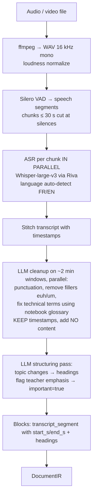

- **Teacher emphasis** (*"ça va tomber à l'examen"*, *"retenez bien"*, *"this is important"*) is tagged `important=true`. It feeds the résumé, the quiz priorities and the podcast.
- **Glossary hint**: course terms from other documents in the notebook help correct ASR mistakes on technical words.
- **Speaker diarization**: skip for v1.

### 5.6 Text and Markdown pipeline

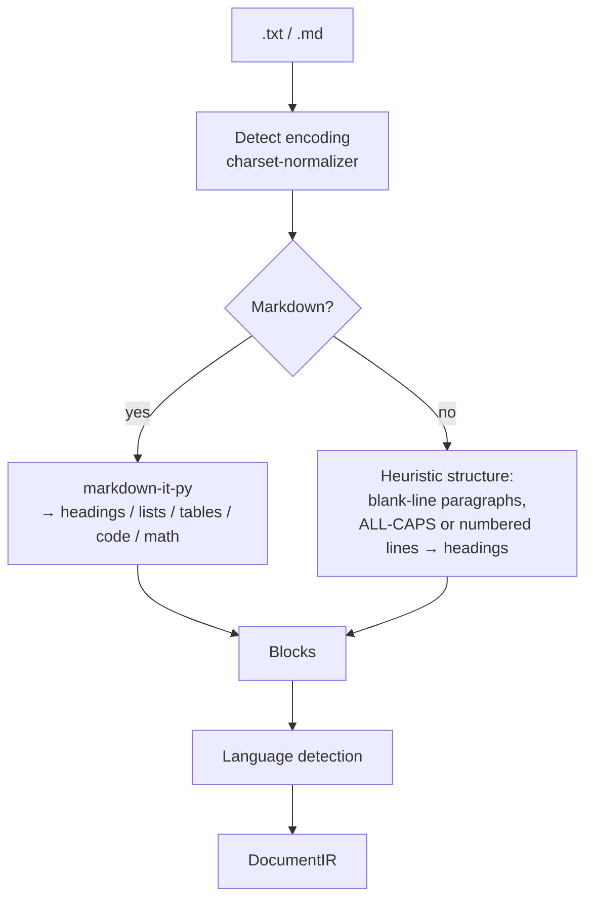

### 5.7 Office pipeline (DOCX / PPTX)

- **Docling** or `python-docx` / `python-pptx` → Markdown blocks.
- PPTX: one slide = one "page", **speaker notes** included. Embedded images go through the image sub-pipeline.

### 5.8 After ingestion: normalization, chunking, indexing, concepts

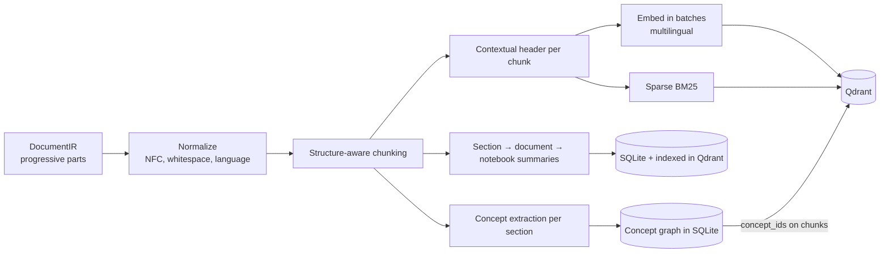

**Chunking rules**
- Split on **structure first** (headings, slides, pages, audio topics), then by size: **400–800 tokens**, **~15% overlap**. Never split a table, a formula, or a list item.
- **Contextual header** before embedding: `"[Course: X] [File: Y] [Section: Ch2 > 2.3 Photosynthesis] "`.
- Payload: `notebook_id, doc_id, filename, kind, page, start_s, end_s, section_path, language, important, extractor, confidence, concept_ids, text`.

**Hierarchical summaries**: section (3–6 bullets) → document → notebook overview with suggested questions.

**Concept extraction** (feeds learning intelligence, §8): per section, the fast LLM lists the concepts taught, with name (FR + EN), a short definition reference and prerequisites. Concepts with the same meaning across documents are merged using embedding similarity plus an LLM confirmation.

---

## 6. Chat (RAG) engine

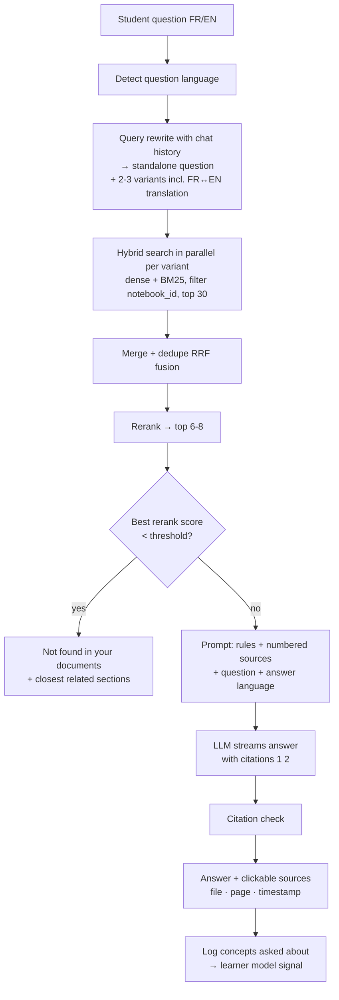

**System prompt rules**
1. Answer **only** from the provided sources. Cite each claim as `[n]`.
2. If the sources don't contain the answer, say so clearly. Outside knowledge only when the student explicitly asks, labelled *"(hors documents / not from your documents)"*.
3. Answer in the **language of the question**.
4. Keep formulas in LaTeX and definitions **word for word** when exact wording matters for the exam.

**Modes**
- **Answer mode** (default).
- **Tutor mode**: Socratic. The bot gives hints and asks guiding questions before revealing the answer. Used from the Learn tab and for weak concepts.

**Special intents**: "summarize chapter 2" → stored section summaries; "compare A and B" → retrieve for each separately; "quiz me" → Learn engine.

---

## 7. Artifacts

### 7.1 Verified exam-night summary ("Résumé de veille d'examen")

Map-reduce makes sure every section is *read*, but it doesn't prove that every important item *ends up in the summary correctly*. So the summary is built around **items with verified sources** and checked **section by section**.

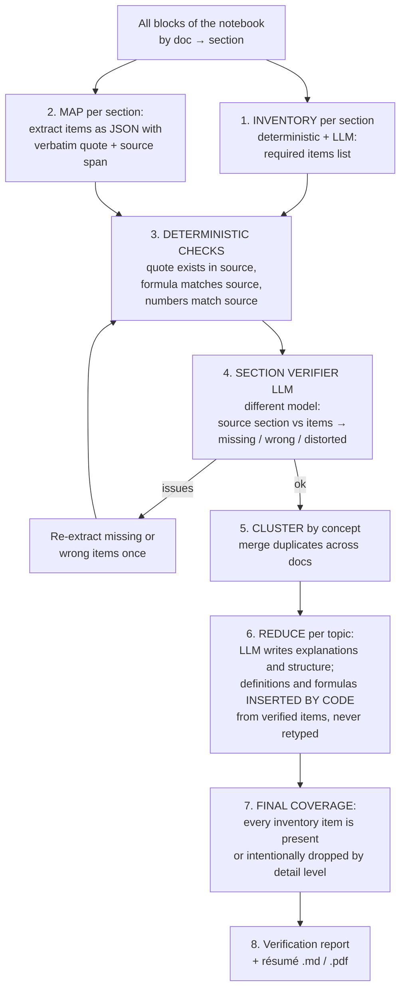

**1. Inventory: what *must* be in the summary**
- **Deterministic detectors** over the blocks: LaTeX/formula blocks; lines with `=` and math symbols; definition patterns (*"on appelle…"*, *"… est défini comme"*, *"définition :"*, *"X is defined as"*, `Term: explanation`); theorem/rule/property headings; bold or boxed terms; numbered lists of rules; dates and numbers with units; `important=true` blocks (teacher emphasis, "à retenir" boxes).
- **LLM inventory** (fast model) adds anything the rules missed: key concepts, methods, cause-effect relations.
- Every inventory item gets an ID and a source span (`doc_id`, `block_id`, character range).

**2. Map: extraction with quotes**
Each item is JSON:
```json
{ "type": "definition", "term": "Photosynthèse",
  "quote": "La photosynthèse est le processus par lequel…",
  "explanation": "…", "source": {"doc": "cours.pdf", "page": 4, "block": "b_112"},
  "inventory_ids": ["inv_37"] }
```
`quote` must be copied **verbatim** from the source. `explanation` is the LLM's own simpler wording, clearly separated.

**3. Deterministic checks (no LLM)**
- **Quote check**: normalize (accents, whitespace, ligatures) and `rapidfuzz.partial_ratio(quote, source_block) ≥ 95`. Fail → item rejected and re-extracted.
- **Formula check**: the formula's normalized LaTeX must equal a formula block in the source. LaTeX must parse. For simple equations, `sympy` checks equivalence when the notation differs.
- **Number check**: every number or unit in the item appears in its source block.
- **Source-quality propagation**: an item whose source block has low OCR confidence or failed the §5.3 double extraction gets a `needs_check` flag.

**4. Section verifier (LLM, ideally a different model family than the writer)**
Input: the full source section + the items extracted from it + the inventory. Output JSON: `missing_items`, `incorrect_items` (with reason), `distorted_definitions`. Formulas and definitions are **always** verified (not sampled). Other items can be sampled to save calls. One fix round, then anything still failing is listed in the report.

**5–6. Cluster and reduce, with insert-by-code**
The reduce LLM writes the structure, the transitions, the "à retenir" points, the pitfalls and the likely exam questions. It **refers** to verified items by ID (`{{item:inv_37}}`), and the code **inserts** the verified quote and formula. The model never retypes a definition or a formula, so it can't introduce errors into them.

**7. Final coverage**
Because items are inserted by ID, coverage is exact: `inventory items present / total`. In "cheat sheet" mode, low-priority items can be dropped, but the report lists them.

**8. Verification report** (shown under the résumé)

| Section | Inventory items | Included | Verified | ⚠️ Needs check | ❌ Missing |
|---------|----------------|----------|----------|----------------|-----------|
| Ch.2 Photosynthèse | 14 | 14 | 13 | 1 (formula, OCR p.12) | 0 |

**Output template**

```markdown
# Résumé — <Course name>
## 🎯 L'essentiel en 10 points
## 📚 Par thème
### Thème 1 — …
- **Définition** : « … » [cours.pdf p.4]  ← verbatim, verified
  - *En clair* : …                         ← simplified explanation
- **Formule** : $…$ — signification de chaque terme [p.7] ✅
- ⚠️ **À vérifier dans ton cours** : $…$ [scan p.12]  ← low-confidence source
- **À retenir** : …
- ⚠️ **Piège fréquent** : …
## 🧮 Formules à connaître (tableau récapitulatif)
## 📅 Dates / chiffres clés
## 🗣️ Ce que le prof a souligné (audio, with timestamps)
## ❓ Questions probables à l'examen (+ réponses courtes)
## 🎯 Tes points faibles (from the learner model, §8; only if the student has practice data)
## ✅ Checklist de révision
```

Options: language (FR/EN), detail level (1-page cheat sheet / detailed), scope (whole notebook or selected files), **focus on my weak concepts**.

### 7.2 Audio podcast

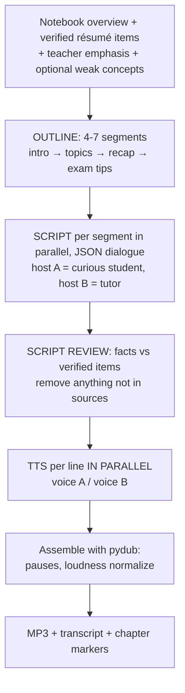

- Script JSON: `[{ "speaker": "A", "text": "...", "segment": 2 }, ...]`.
- Lines under 40 words. Numbers and formulas **written as spoken words** ("x au carré").
- Lengths: **short** (~5 min) and **deep dive** (~15 min). Option: **"my weak points"** podcast.
- TTS results are cached per line, so editing one line re-renders only that line.

---

## 8. Learning intelligence

The goal: the system doesn't only *produce* content. It **measures what the student understands**, finds **what they struggle with**, and **adapts** revision to it.

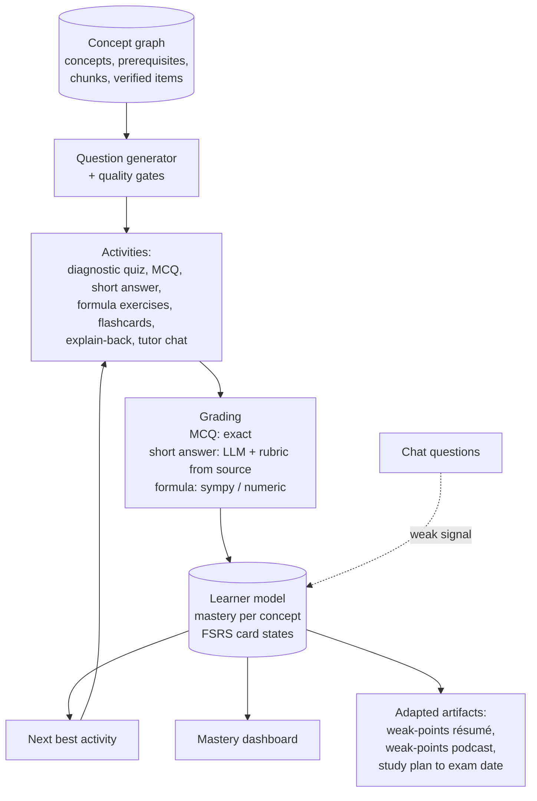

### 8.1 Concept layer
- Built at ingestion (§5.8): `concepts(id, notebook_id, name_fr, name_en, importance, verified_item_ids, chunk_ids)` and `concept_edges(from, to, type='prerequisite'|'related')`.
- **Importance** comes from: teacher emphasis, number of sources that mention it, presence in the "likely exam questions", and a definition/formula attached to it.
- This is also the data behind a **mind map** view.

### 8.2 Activities

| Activity | Purpose | Bloom level |
|----------|---------|-------------|
| **Diagnostic quiz** (10–15 questions across the main concepts) | Initial mastery estimate | remember → apply |
| **MCQ** | Fast checks, deterministic grading | remember / understand |
| **Short answer** | Real understanding, not recognition | understand |
| **Formula / application exercise** | Use a formula with numbers taken from the course | apply |
| **Flashcards** (definitions, formulas, dates) | Long-term memorization, scheduled with **FSRS** | remember |
| **Explain-back** ("explique-moi X avec tes mots") | Detects misconceptions | understand |
| **Tutor chat** (Socratic mode) | Remediation on weak concepts | all |

### 8.3 Question generation with quality gates
Each generated question must pass these gates before a student sees it:
1. **Grounded**: it cites the verified item or chunk it comes from. The verifier LLM confirms the answer is in that source.
2. **Single correct answer** (MCQ): the verifier answers the question blind (without the answer key). If it disagrees with the key, the question is rejected.
3. **Plausible distractors**: wrong options come from **confusable concepts** (neighbours in the concept graph) or common misconceptions, not random nonsense.
4. **Not trivial / not ambiguous**: an LLM check plus dedup against existing questions (embedding similarity).
5. Tagged with `concept_ids`, `difficulty`, `bloom_level` and `language`.

Questions are generated in batches in the background and stored, so quizzes start instantly.

### 8.4 Grading
- **MCQ / flashcards**: deterministic (flashcards also use the student's self-rating: again / hard / good / easy).
- **Short answer / explain-back**: LLM grader with a **rubric built from the verified items** (key points expected). It returns a score, which key points were present or missing, feedback, and a citation to the course. Show the rubric to the student and let them **contest** a grade. Contested grades are logged for review.
- **Formula exercises**: compute the expected result with `sympy`, compare numerically with tolerance, and give step feedback.

### 8.5 Learner model
Per `(student, concept)`:
- `mastery` ∈ [0, 1]: start with a simple, explainable update (weighted moving average by difficulty: correct on a hard question raises it more; errors lower it). Upgrade to Bayesian Knowledge Tracing later if needed.
- `confidence` (how much evidence), `last_practiced`, `attempts`, `error_types`.
- **FSRS card state** per flashcard.
- **Signals**: quiz and flashcard results (strong), explain-back scores (strong), hints used in tutor mode (medium), the same concept asked about repeatedly in chat (weak).
- **Prerequisite propagation**: if the student fails concept B and its prerequisite A has low confidence, propose A first.

### 8.6 Adaptation
- **Next best activity** = highest `importance × (1 − mastery)`, plus FSRS cards that are due, plus prerequisites first.
- **Mastery dashboard**: concepts by chapter, coloured by mastery, with "not yet practiced" shown separately (unknown ≠ weak).
- **Weak-points résumé and podcast**: the same artifact engines, scoped to low-mastery concepts.
- **Study plan**: the student enters the exam date. The plan spreads concepts and reviews over the remaining days by importance and mastery, and updates after each session.

### 8.7 Data model (SQLite)
`concepts`, `concept_edges`, `questions`, `flashcards`, `attempts(student_id, question_id, answer, score, feedback, rubric_hits, created_at)`, `mastery(student_id, concept_id, mastery, confidence, updated_at)`, `fsrs_cards`, `study_plans`.

### 8.8 Guardrails
- Mastery is a **study guide**, not a grade. Never show it as a mark.
- LLM grading can be wrong: always show *why* (rubric points + source) and allow contesting.
- Evaluate question quality in Phase 7 with a sample reviewed by hand (target: > 90% of questions judged correct and useful).

---

## 9. Bilingual (FR / EN) handling

| Point | How |
|-------|-----|
| Document language | Detected per block (`lingua`), stored in the chunk payload |
| Cross-language retrieval | **Multilingual embedding model** + FR↔EN query variants |
| Answer language | Language of the question, overridable in settings |
| Artifacts, quizzes | Language chosen by the student. Verbatim quotes stay in the **source language**, and the explanation is in the chosen language. |
| Concepts | Stored with FR and EN names so mastery is shared across languages |
| ASR | Whisper auto-detects the language per segment |
| TTS | Separate FR and EN voice pairs |
| Eval | FR→FR, EN→EN, **FR question→EN doc**, **EN question→FR doc** |

---

## 10. Accuracy strategy

1. **Good extraction**: page analysis, image OCR, missed-text detector, formula double extraction, and the IR viewer with page images side by side.
2. **Hybrid retrieval + reranker.**
3. **Grounded prompts + mandatory citations + "not found" behavior.**
4. **Verified résumé**: inventory → quotes → deterministic checks → section verifier → insert-by-code → exact coverage report.
5. **Question quality gates** for learning activities.
6. **Evaluation sets** (from Phase 2), re-run after every change, scores tracked in a CSV:
   - *Extraction*: character accuracy on ~20 hand-transcribed pages (scanned, images with text, formulas)
   - *Retrieval hit@k*, *answer correctness*, *faithfulness*, *refusal correctness*
   - *Résumé*: inventory recall, % of verified formulas/definitions, items flagged by a human
   - *Questions*: % judged correct and useful in a manual review

---

## 11. Streamlit dev UI

> There are **two** Streamlit apps. This section describes the **developer UI** (`assistant/app/streamlit_app.py`). The **student interface** (`assistant/app/student_app.py`) is the NotebookLM-style product screen (Sources · Chat · Studio) used for validation with the teacher. It reads everything through `assistant/app/student_backend.py`, which serves sample data until each phase makes the matching function real (see "Two interfaces" in `docs/phases/README.md`).

Sidebar: pick or create a **notebook**, choose the test **student profile**, and see background job status.

| Tab | Contents |
|-----|----------|
| 📥 **Sources** | Multi-file uploader · **live progress per file** (stage, done/total, ETA, retry) · type & language · **IR viewer with page image side by side**, page class, extractor per block, confidence, warnings |
| 💬 **Chat** | Streaming answers · answer/tutor mode · language toggle · source cards · **debug**: rewritten queries, chunks + scores before/after rerank, prompt, tokens, latency |
| 📝 **Résumé** | Options (language, detail, scope, weak-points focus) · generation progress per section · rendered résumé · **verification report** · download `.md` / `.pdf` |
| 🎧 **Podcast** | Options · script preview/edit · audio player · download MP3 |
| 🎓 **Learn** | Diagnostic quiz · practice session (next best activity) · flashcards · explain-back · **mastery dashboard** · study plan · contested grades |
| 🧪 **Eval** | Run eval sets · results table · comparison with previous runs |
| ⚡ **Performance** | Time per stage, cache hit rates, API calls / 429s per model, queue depth |
| ⚙️ **Settings** | Model IDs per role, limits per model, chunking params, thresholds, pipeline versions |

---

## 12. Environment setup (Windows, venv)

```powershell
# everything runs from the repo root: D:\Khoula\E-learning
& "$env:LOCALAPPDATA\Programs\Python\Python313\python.exe" -m venv .venv
.\.venv\Scripts\Activate.ps1          # if blocked: Set-ExecutionPolicy -Scope CurrentUser RemoteSigned
python -m pip install --upgrade pip
pip install -r assistant\requirements.txt
copy assistant\.env.example .env      # put your build.nvidia.com key in NVIDIA_API_KEY

# Qdrant server (docker-compose.yml; data in a Docker named volume)
docker compose up -d
# or run everything (Qdrant + worker + UI) in containers: docker compose --profile app up -d --build
# terminal 2: background worker
python -m assistant.worker
# terminal 3: UI
streamlit run assistant\app\streamlit_app.py
```

**System dependencies**: **ffmpeg** (`winget install Gyan.FFmpeg`). Optional: **Docker Desktop** (Qdrant server; Redis if you want to try it).

**Initial `requirements.txt`** (pin exact versions once it works):
```
streamlit
openai
nvidia-riva-client
pydantic
python-dotenv
pyyaml
tenacity
aiolimiter
pymupdf
pymupdf4llm
rapidocr-onnxruntime
pillow
filetype
charset-normalizer
markdown-it-py
lingua-language-detector
qdrant-client[fastembed]      # fastembed provides BM25 sparse vectors
pydub
silero-vad
python-docx
python-pptx
rapidfuzz
sympy
networkx
fsrs
pytest
```
Optional later: `docling`, `faster-whisper`, `paddleocr`, `piper-tts`, `ragas`, `weasyprint` / `markdown-pdf`, `redis`.

**`.env.example`**
```
NVIDIA_API_KEY=nvapi-xxxxxxxx
NVIDIA_BASE_URL=https://integrate.api.nvidia.com/v1
```

**`.gitignore`**: `.venv/`, `.env`, `data/`, `__pycache__/`.

---

## 13. Implementation phases

Each phase ends with something you can **test in Streamlit**. Don't start a phase until the previous one works.

> **Task-by-task implementation guides** for every phase are in [docs/phases/](phases/README.md). The checklists below are the summary.

### Phase 0: Foundations + runtime (≈ 1 week)
- [ ] Repo structure, venv, `requirements.txt`, `.env`, `config.yaml`, `.gitignore`
- [ ] SQLite schema (WAL): notebooks, documents, jobs, tasks, cache, metrics
- [ ] `runtime/`: `JobQueue`, per-model `RateLimiter` with interactive/background priorities, `CallCache`, progress + ETA, metrics
- [ ] Async providers: `llm` (incl. streaming), `embeddings` (batched), `rerank`, with retries and fallbacks
- [ ] `worker.py` that claims jobs and runs tasks concurrently
- [ ] Smoke test script: one chat model, one embedding model, one reranker, one OCR call
- [ ] Pydantic models: `Block`, `DocumentIR`, `PageReport`, `Chunk`, `Citation`
- [ ] Streamlit: notebook select + a demo job with a live progress bar + Performance tab
- **Done when**: a demo job of 100 fake LLM tasks runs in parallel within rate limits, shows live progress, survives a worker restart, and a second run is fully cached.

### Phase 1: TXT/MD + the full PDF pipeline → chat (≈ 2 weeks)
- [ ] Router (type detection, hashing, dedup)
- [ ] Text/Markdown pipeline
- [ ] PDF: page analysis → TEXT / MIXED / SCANNED / COMPLEX routing
- [ ] Embedded image extraction, dedup, OCR / VLM sub-pipeline
- [ ] Full-page parse for scanned pages; page-elements for complex pages
- [ ] **Missed-text detector**
- [ ] Merge in reading order, headers/footers, hyphenation
- [ ] Chunker + contextual headers, Qdrant **hybrid** index, **progressive indexing**
- [ ] Chat: retrieve → rerank → streaming grounded answer with citations
- [ ] Streamlit: Sources tab (progress + IR viewer with page images) + Chat tab
- [ ] Compare against **Docling** on 5 of your real PDFs; keep the better approach
- **Done when**: on a PDF with digital text + **screenshots containing text** + a scanned page, all text appears in the IR, and a question about text that exists **only inside an image** is answered with the right page cited.

### Phase 2: Accuracy and evaluation (≈ 1 week)
- [ ] Eval sets: 2 notebooks (FR, EN), ~50 questions each incl. cross-language and "not in documents"; ~20 hand-transcribed pages for extraction accuracy
- [ ] `eval/run_eval.py` + Eval tab
- [ ] Query rewrite with history + FR↔EN variants, RRF fusion
- [ ] "Not found" threshold calibration
- [ ] Compare 2–3 chat LLMs and 2 embedding models **on your French material**; fix the choices in `config.yaml`
- [ ] Hierarchical summaries + notebook guide
- **Done when**: retrieval hit@8 ≥ 90%, answer correctness ≥ 85% (adjust to your data).

### Phase 3: Images + Office (≈ 1 week)
- [ ] Image pipeline: preprocessing, VLM type classification, OCR / VLM, cleanup
- [ ] Handwritten notes test set (phone photos)
- [ ] Formula **double extraction** (§5.3 step D)
- [ ] Office pipeline (DOCX/PPTX + speaker notes)
- **Done when**: photos of handwritten notes produce readable IR, and formula disagreements are flagged.

### Phase 4: Audio (≈ 1 week)
- [ ] ffmpeg + VAD chunking, **parallel ASR**, local `faster-whisper` fallback
- [ ] Transcript cleanup + headings + teacher-emphasis tagging
- [ ] Timestamp citations; Streamlit plays the audio from that point
- **Done when**: a 1-hour French lecture is searchable with correct timestamps in under ~10 minutes.

### Phase 5: Verified résumé + concepts (≈ 2 weeks)
- [ ] Concept extraction + concept graph (§5.8, §8.1)
- [ ] Inventory (deterministic detectors + LLM)
- [ ] Map with verbatim quotes
- [ ] Deterministic checks (quotes, formulas, numbers) + source-quality flags
- [ ] Section verifier with a different model + one fix round
- [ ] Cluster, reduce with **insert-by-code**, final coverage
- [ ] Verification report, export `.md` / `.pdf`
- **Done when**: on a full course notebook, inventory recall ≥ 95%, 100% of included formulas/definitions pass deterministic checks or are flagged ⚠️, and a manual review of 2 chapters finds no wrong formula or definition.

### Phase 6: Podcast (≈ 1 week)
- [ ] Outline → script JSON → fact review against verified items
- [ ] Parallel TTS with two voices per language, cached per line
- [ ] Assembly → MP3 + transcript; edit-before-render
- **Done when**: a natural 5-minute FR podcast is generated with no invented facts.

### Phase 7: Learning intelligence (≈ 2 weeks)
- [ ] Question generation (MCQ, short answer, formula exercises, flashcards) + **quality gates**
- [ ] Grading (deterministic, rubric-based LLM, sympy) + contest flow
- [ ] Learner model (mastery per concept) + FSRS
- [ ] Diagnostic quiz, next best activity, tutor mode in chat
- [ ] Mastery dashboard, weak-points résumé and podcast, study plan
- [ ] Mind map view from the concept graph
- **Done when**: after a diagnostic quiz and two practice sessions, the dashboard correctly shows the concepts you deliberately got wrong as weak, and > 90% of a reviewed sample of questions is correct and useful.

### Phase 8: Integration into the E-learning platform (later)
- [ ] FastAPI service wrapping `core` (upload, chat via SSE streaming, artifacts, learning, job status)
- [ ] **Redis** for the job queue (Celery/Arq), shared cache, cross-process rate limits and live progress (pub/sub); **Postgres** for durable data; Qdrant server
- [ ] Auth + per-student isolation, object storage (S3-compatible)
- [ ] Review NVIDIA API terms and quotas for production (paid or self-hosted NIM, or other providers behind the same `providers/` interface)

---

## 14. Risks and mitigations

| Risk | Mitigation |
|------|------------|
| Free-tier rate limits / quota | Async + limiters, multi-level caching, local work first (text layer, local OCR check), API only where needed, local fallbacks |
| Slow ingestion of large files | Parallel tasks, progressive availability, resumable tasks, progress + ETA in UI |
| Text hidden in images / vector text missed | Page analysis + image OCR + **missed-text detector** + IR viewer with page images |
| Wrong formulas or definitions in the résumé | Verbatim quotes, deterministic checks, double extraction, section verifier, insert-by-code, ⚠️ flags |
| Bad quiz questions or unfair grading | Quality gates, blind-answer check, rubric shown, contest flow, manual review sample |
| Model IDs disappear or change | All IDs in `config.yaml`, fallback list per role |
| Weak French quality on some models | Phase 2 eval on French material decides |
| Student data privacy | Local in dev. Before production, decide what goes to external APIs, and keep learner data per student, with the right to delete it. |

---

## 15. Immediate next steps

1. Create an API key on `build.nvidia.com` and check that the models in §2.4 (including the OCR / page-elements ones) are available to your account. Note each model's real rate limit.
2. Collect **real test material**: a French course PDF **with screenshots/images containing text**, a scanned handout, a PDF with formulas, phone photos of handwritten notes, one teacher recording, and one English document.
3. Read the design of NVIDIA's **NeMo Retriever extraction** (NV-Ingest) pipeline.
4. Start **Phase 0**.
